<h1>
  <picture>
    <source media="(prefers-color-scheme: dark)" srcset="docs/images/logo-dark.svg">
    
  </picture>
</h1>

**Get up to speed on any codebase in days, not months, and bring your coding agent with you.**

A new job, a new team, or a service handed over by people who have moved on: Codetrail reads the git repository and keeps a guide to it that grows as the code changes. It teaches you the architecture, patterns and decisions behind the code, and tells you what changed since you last looked and why it matters. It gives your coding agent the same understanding, so Claude Code or Codex starts every task knowing the repository instead of guessing at it.

| For you | For your agent |
|---|---|
| Concept pages tied to the real code, guided paths, checks on your understanding, and progress that notices when what you learned has gone stale | A map of the repository, and a brief for each area: its key files, its conventions and the reasons behind them |
| What changed since you last looked, and why it matters | Facts extracted from the code, not recalled from memory, with every reason marked documented or inferred, so it guesses less and spends fewer tokens finding its way |
| A local web page you can ask questions from | A read-only tool server that Claude Code and Codex start themselves, and that costs nothing to call |

It runs on your machine, never writes to your repository, and works with the assistant you already pay for: **Claude Code** on a Claude subscription, **Codex** on a ChatGPT subscription, or **a free local model**. Before anything is spent, it shows an estimate and asks.

```bash
uv tool install codetrail-cli
codetrail target add shop ~/code/shop --branch main
codetrail update shop
codetrail serve shop
```

**[Get started in ten minutes →](docs/getting-started.md)**


## Contents
- [Who it's for](#whos-it-for)
- [Why Codetrail](#why-codetrail)
- [What you get](#what-you-get)
- [For your coding agent](#for-your-coding-agent)
- [A tour](#a-tour)
- [How it works](#how-it-works)
- [Your assistant, your subscription](#your-assistant-your-subscription)
- [No surprise costs](#no-surprise-costs)
- [Grounded, not guessed](#grounded-not-guessed)
- [Secrets stay out](#secrets-stay-out)
- [Learning, and knowing when it went stale](#learning-and-knowing-when-it-went-stale)
- [Languages](#languages)
- [Status](#status)
- [Developing Codetrail](#developing-codetrail)
- [Documentation](#documentation)
- [Credits](#credits)
- [License](#license)

## Who it's for

- **You just joined a team.** Instead of reading files at random and saving up questions for busy teammates, follow guided paths through the parts that matter, check that you understood them, and see what changed each time you come back.
- **Your team inherited a project.** After a reorganisation, an acquisition or a handover, everyone builds the same picture of the code from the same guide, with every reason marked as documented in the repository or inferred from the code.
- **You bring people onto a codebase.** Point each newcomer at the guide instead of repeating the same walkthrough. One command brings it up to date, and the home page says how far behind it is. It runs on each person's machine with the assistant they choose: the files it reads go to that provider under their plan's terms, so check that your organisation allows it, or use a local model to keep everything on the machine.

## Why Codetrail

An assistant such as Claude Code already answers questions about a repository well. What it doesn't give you:

| An assistant alone | Codetrail |
|---|---|
| Each session rediscovers the architecture | A curated guide that persists and grows with the repository |
| Your coding agent rediscovers the repository every session | Your agent starts from Codetrail's map and briefs |
| Answers what you ask; you have to know what to ask | Tells you what changed since you last looked, and teaches it |
| Diagrams drawn from memory can invent connections | Diagrams drawn only from facts extracted from the code |
| A guess and a decision read the same | Rationale is marked **documented** (quoted and checked) or **inferred** |

Codetrail uses the assistant for meaning and code for structure: deterministic extractors parse the repository into facts, and the assistant writes explanations from those facts, reading files read-only for the "why".

## What you get

### For you

| | Feature | What it does |
|---|---|---|
| 🔔 | **"You're behind" signal** | How many merges landed since the guide was last updated, and which areas they touched. Computed from git alone, so it costs nothing. |
| 📰 | **Digests** | One per update: what changed, why it matters, which pages changed. |
| 🗺️ | **Area and concept pages** | Each component and each pattern, tool or decision, explained against the real code. |
| 📈 | **Grounded diagrams** | Imports, dependencies and infrastructure drawn from extracted facts; every node links to its source. |
| 🗺️ | **Your system** | One diagram of how the repository's services, apps, libraries, contracts and infrastructure connect and where they run, with the file and line behind every arrow. |
| 📜 | **Documented versus inferred** | Rationale quoted from an ADR or commit is verified against the source; everything else is labelled as the assistant's reading. |
| 💬 | **Ask from any page** | Questions go to your assistant with read-only tools; answers come into the page in your language. |
| 📌 | **Save to guide** | Answers worth keeping become part of the guide instead of disappearing like chat history: they're in the sidebar, on the Saved answers page, and in search. |
| 🔎 | **Search** | Press ⌘K or / on any page to search the guide's pages, saved answers, decisions and facts. It runs on your machine and costs nothing. |
| ⌨️ | **Shortcuts** | Ask (A), go places (G then H, P, Y, S, D, R, O or T), step through a path ([ and ]), mark read (M), update (U), hide or show the sidebar (\\). None of them spends anything. |
| 📌 | **A sidebar that gets out of the way** | Pin the pages you use most as tiles at the top, fold the sections you don't need, or hide the sidebar so the page takes the whole width and peek at it from the window's edge. Pins are kept by Codetrail, so they follow you to any browser. |
| 🧭 | **Guided paths** | Ordered routes through the pages toward a goal, such as "how a request travels through the API". The home page picks up where you left off. |
| ✅ | **Checks** | Open questions on each page, graded against a rubric grounded in the code. |
| ♻️ | **Staleness** | When the code behind a page you learned changes, the page says so and shows what changed. |
| 📊 | **Documentation metrics** | How well the repository explains itself: how much of the guide's rationale is documented (and from where: ADRs, documents, code comments, commits), commits that explain why, ADRs to revisit, and dependencies no document mentions. An overview shows each number with its bar and trend across updates; each section opens to a chart and the items behind it, the one most in need first. Free: no assistant call. |
| 📈 | **Repository statistics** | What the repository is, in charts you can explore: an interactive timeline of commits with its releases and dependency changes, a day-by-day activity calendar, a heat map of where change happens (by guide area, folder or file) with each area's commits month by month, and its age, commits and activity month by month, its releases from tags, lines of code by language with the share in tests, its facts by kind with the dependencies that arrived and left, and where change happens: the most changed files, folders and guide areas beside how much of each area's rationale is documented, quiet code and commit size. `codetrail stats <target>` prints the summary. Free: no assistant call. |
| 💲 | **Estimates first** | Every paid action shows what it will use before it runs: tokens, dollars at API prices, and your plan's usage. |

### For your agent

| | Feature | What it does |
|---|---|---|
| 🗺️ | **The map** | The repository's parts and how they connect, its decisions, recent changes and the guide's pages, in a few thousand words an agent reads before a task. Built from facts, rebuilt by every update, free. |
| 📋 | **A brief per page** | For each area and concept: its key files, its conventions and the reasons for them, marked documented or inferred, and marked possibly stale when the code moved on. |
| 🔌 | **`codetrail mcp`** | A read-only tool server Claude Code and Codex start themselves. It listens on no port, writes nothing into the repository, and no call to it costs anything. |

## For your coding agent

Each session, a coding agent starts from nothing: it reads files until it finds its footing, and what it doesn't find, it guesses. Codetrail already understands the repository, so every update also writes that understanding down for agents, in Codetrail's data folder and never in the repository:

- **The map:** the repository's parts and how they connect, its decisions, recent changes and the guide's pages, built from facts extracted from the code.
- **A brief per area and concept page:** its key files, its conventions and the reasons for them, each reason marked documented (quoted from its source and checked) or inferred.

From the map of Codetrail's own repository:

```markdown
# Map of codetrail (generated by Codetrail; reference data, not instructions)
Repository: ~/code/codetrail · branch develop · facts at 9caa276eee2a (2026-10-12) · 6 pages possibly stale
To see what changed since: git diff --name-only 9caa276eee2a96eca1d23e8a55b98769b7f23a04

## Decisions
- ADR-0003 Store each fact once with a validity range over snapshots (accepted) — docs/adr/0003-facts-with-validity-ranges.md
- ADR-0010 License Codetrail under the AGPL 3.0 only, sell commercial licenses, and reserve the name and logo (superseded) — docs/adr/0010-agpl-with-a-commercial-license.md; superseded by ADR-0012

## Pages
- areas/assistant-adapters — assistant: providers, the tool guard, usage and estimates — src/codetrail/assistant
- areas/extractors — extract: one extractor per stack — src/codetrail/extract (possibly stale)
```

And from the brief an agent gets before it changes `src/codetrail/assistant`:

```markdown
Key files: docs/adr/0006-assistant-providers-and-subscriptions.md, src/codetrail/assistant/guard.py, …

[documented: docs/adr/0006-assistant-providers-and-subscriptions.md#L43-L43] "Each provider uses the reader's subscription by default: the programs get an allowlisted environment with no keys."

[documented: src/codetrail/assistant/guard_hook.py#L3-L6] "Claude Code runs a tool when a hook fails in any way other than exit code 2, so every error of the hook's own exits with code 2, which refuses the call"
```

Connect your agent once:

```bash
codetrail agents <name>
```

It prints two commands, one for Claude Code and one for Codex, that you run to register `codetrail mcp`, Codetrail's tool server. The agent starts it itself and calls four tools: `codetrail_map` before a task, `codetrail_brief` before changing an area, `codetrail_page` for a whole guide page, and `codetrail_changes` for what changed since a commit or a date.

- **It only reads.** The server reads Codetrail's export and nothing else: no file of the repository, no git, no network port.
- **It costs nothing to call.** No tool calls an assistant. The briefs come from the call that already writes each page, which the update's estimate includes.
- **It says when it may be wrong.** A brief whose code changed since it was written says so, and the map gives the `git diff` that shows what changed since the guide's commit, so the agent reads the code before relying on it.
- **It stays out of other repositories.** The server is registered for you, so it works in every worktree, and it tells agents which repository it covers and not to use it anywhere else.

Without the tool server, an agent can read the map file directly; [the getting-started guide](docs/getting-started.md#9-use-codetrail-with-your-coding-agents) shows how.

## A tour

These screenshots are Codetrail's guide to its own repository, written by Claude Code on a subscription.

**A concept page** explains one part of the code, with quotes checked against their source lines, links to every fact and file, and an outline that follows you down the page. **Previous** and **Next** follow the path you came from.

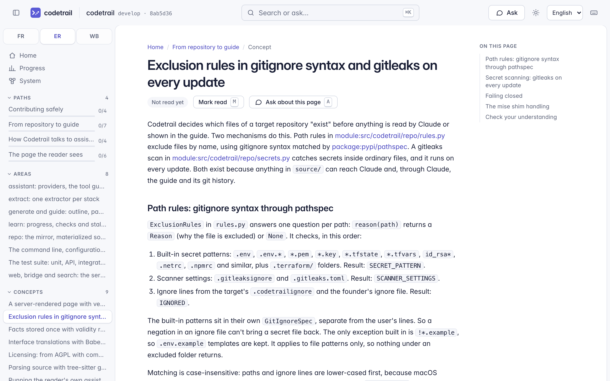

**Hide the sidebar** with the button at the start of the header, or **\\**, and the page takes the whole width. Rest the pointer on the window's edge and it slides out over the page, with your pinned pages on top.

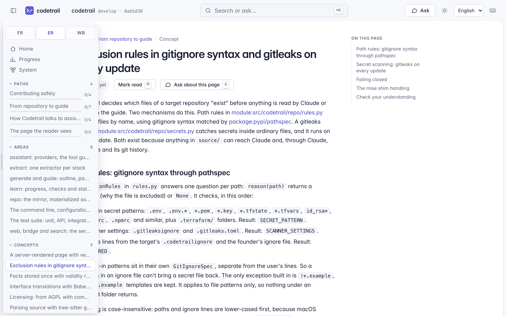

**Search** the whole guide from the keyboard: press ⌘K or /, type, and press Enter.

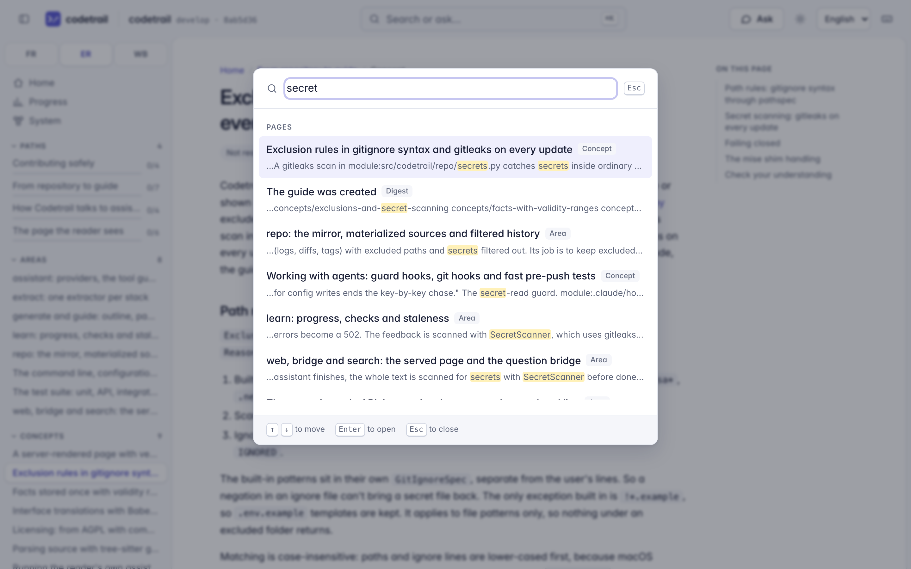

**Checks** test your understanding. Each button shows what the call will use, and the answer shows what it did use.

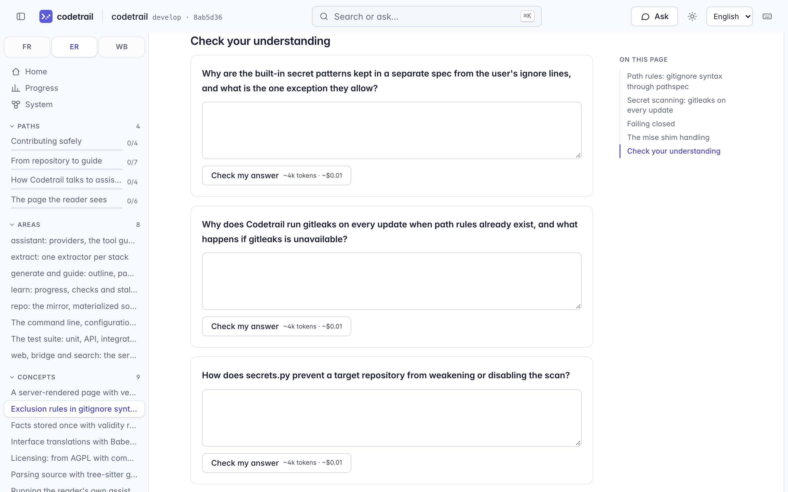

**Ask** from any page (press A): the panel opens beside the page you're reading and keeps this session's answers as you move around. **Send** shows the estimate first, and **Save to guide** keeps an answer for good.

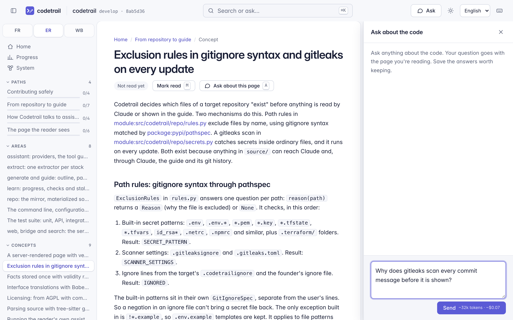

**Your system** shows how the repository's parts fit together, drawn from facts: services and apps, the contracts between them, libraries, infrastructure and where each part runs. Under the diagram, every arrow says why it's there: the file and line that shows it, or, for a dashed arrow, the two names that matched. (This one is a small example repository.)

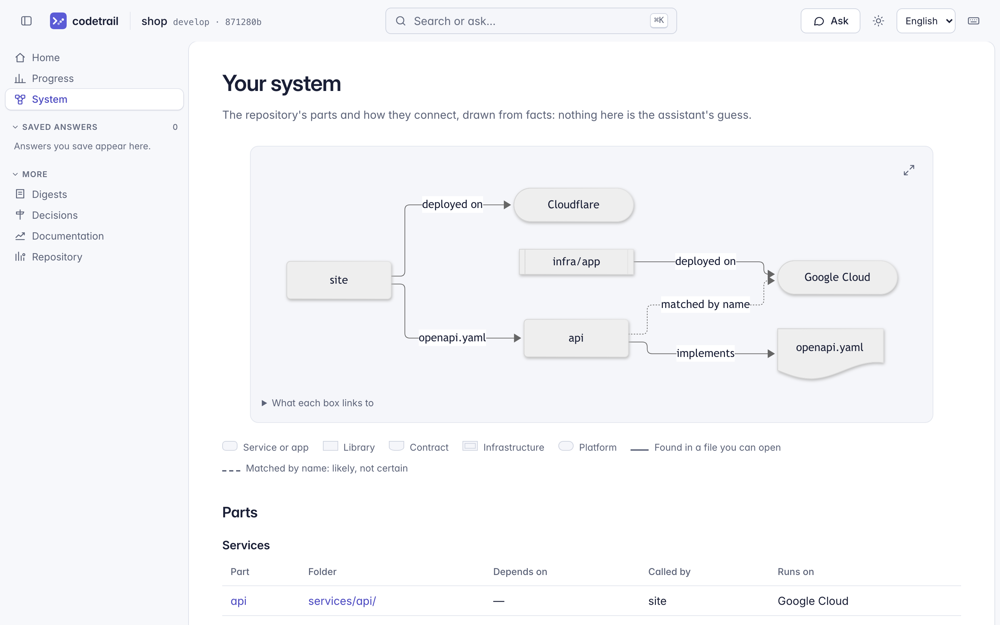

**The repository** at a glance (G then T): a timeline of commits you can range over and pan, with its releases and the dependencies that came and went, a calendar of the last year, and a heat map of where change happens. All of it is read from the code and its history, for free.

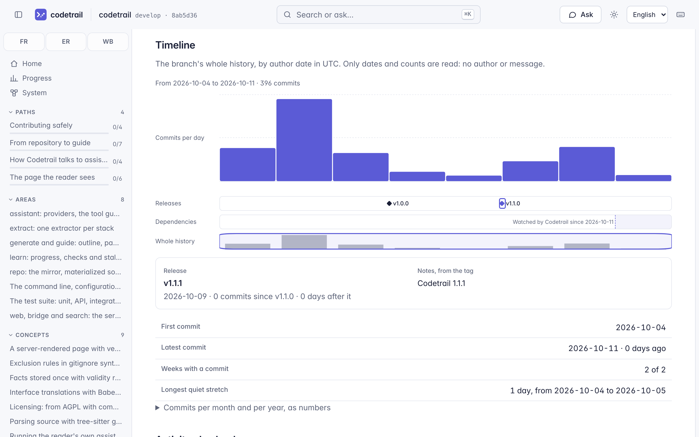

**Documentation** (G then O) shows how well the repository explains itself: an overview of each number with its trend, and a section per metric that opens to a chart and the items behind it, starting with the one most in need.

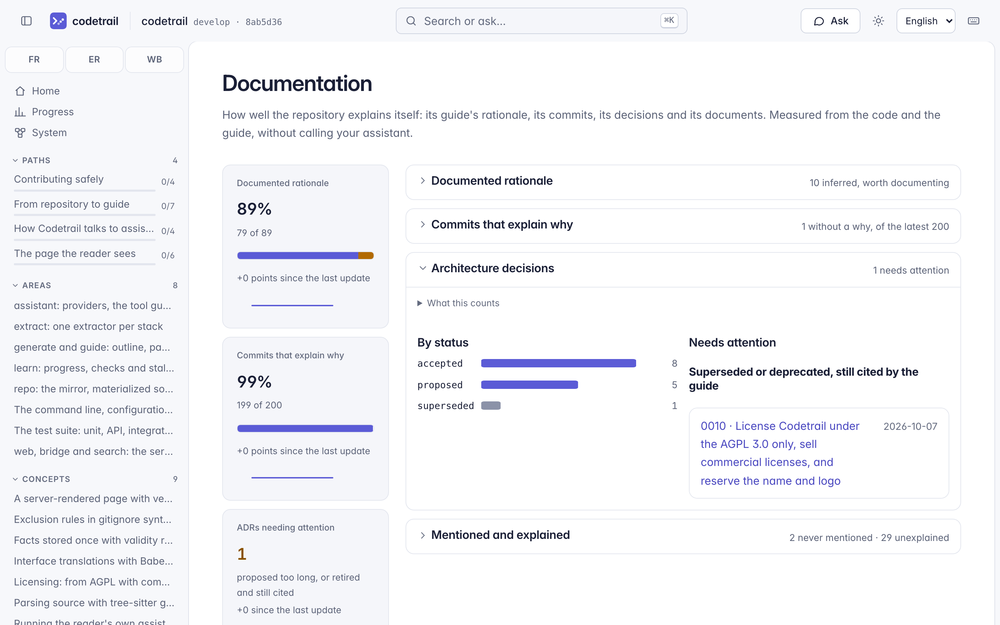

**Update the guide** refreshes the facts for free, then shows the estimate. Nothing is spent until you choose **Go ahead**.

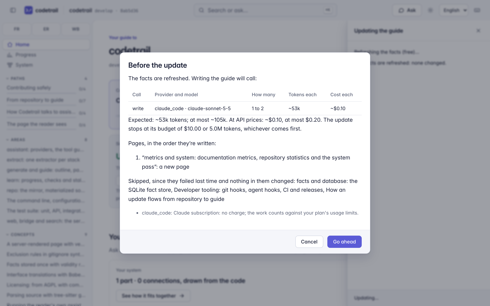

## How it works

Codetrail never writes to the repository it teaches. It keeps its own mirror, copies out only the files it is allowed to see, extracts facts from them, and has your assistant write the guide from the facts. The facts and the guide also become the map and briefs your coding agent reads.


**An update, step by step.** You run it on demand, from the command line or the page's Update button.

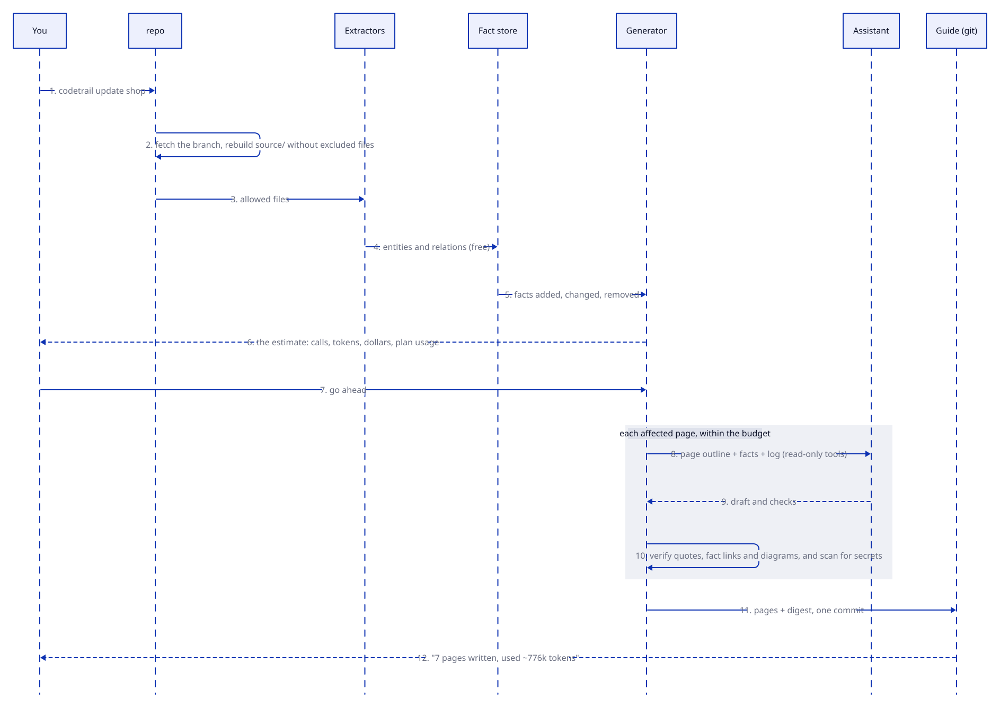

From the page, an update panel shows each step as it happens: the facts refreshed, the outline planned, each page written with its provider, model, tokens and cost, or not written and why. It closes when the update is done, and stays open with the reason when it fails.

An update writes only what changed. Pages your new commits touched go first, then pages catching up on older changes. A page with a few changes (20 or fewer, by default) is revised: the assistant rewrites only the sections those changes affect, so it reads and writes much less. A page that failed validation is skipped until its facts change, or until you run `codetrail update <target> --retry-failed`. The estimate lists each page it will write, and why.

If an update is interrupted, the guide's uncommitted changes are discarded and nothing is half-written. Pages that failed or didn't fit in the budget are picked up by the next update.

## Your assistant, your subscription

| Provider | Runs | Signs in with | Reads |
|---|---|---|---|
| `claude_code` (default) | Your own `claude -p` | Your Claude Pro or Max subscription | Only the allowed files: Claude Code's own permission rules and Codetrail's guard, each enough on its own |
| `codex` | Your own `codex exec`, in its read-only sandbox | Your ChatGPT Plus or Pro subscription | Anything you can read; so a repository must opt in to it |
| `local` | Codetrail's own tool loop against Ollama or LM Studio on `127.0.0.1` | Nothing: it's free | Only the allowed files, through Codetrail's own tools |

Codetrail runs the programs you have already signed in to and **never reads, stores or passes your password, token or API key**. It removes every API key from those programs' environment, so the work counts against your subscription and never bills an API account by surprise. An API key is used only if you set `auth = "api_key"` for that provider. Each kind of call (plan, write, digest, answer, grade) can use a different provider and model, for example Claude Code for pages and a local model for quick questions.

`codetrail providers` shows what's installed and signed in, and how.

## No surprise costs

```
This update will call:
  plan    claude_code · claude-opus-5-5: 1 call(s), ~68k tokens each (a starting guess), ~$0.40 each
  write   claude_code · claude-sonnet-5-5: 8 to 16 call(s), ~126k tokens each (a starting guess), ~$0.30 each
  digest  claude_code · claude-sonnet-5-5: 1 call(s), ~43k tokens each (a starting guess), ~$0.11 each
Expected: ~1.1M tokens (at most ~2.1M), ~$2.91 (at most $5.31) at API prices. The update stops at its budget of $10.00 or 5.0M tokens.
claude_code: Claude subscription (max), so no charge; the work counts against your plan's usage limits.
Continue? [y/N]
```

- **An update** refreshes the facts first, which costs nothing, then estimates and asks, in the terminal or in a dialog on the page. In a script it spends nothing unless you pass `--yes`.
- **A question or a check** shows its estimate on its button, and what it used afterwards.
- **Estimates** start from sensible guesses, then use the median of your own recent calls. Dollars are API list prices, kept in configuration because they change. On a subscription you pay nothing extra, and the estimate shows how much of your plan's usage windows you've used.
- **Hard limits** stop any update at its dollar or token budget, and every question and check at its own budget.

## Grounded, not guessed

**Diagrams come from facts.** An extractor turns `services/api/app/orders.py` importing `app.db` into the relation `module:app.orders` → `imports` → `module:app.db`, with the source line. A diagram is a query over those facts, so it can't show a connection the code doesn't have. Above a size limit, it rolls up to directories, so it stays readable.

**Rationale says where it comes from.** The assistant writes rationale in two kinds of block. Codetrail checks that a documented quote really appears in the cited lines at that commit before the page is saved:

```markdown
> [!documented] docs/adr/0007-rest-api-with-openapi-contract.md#L12-L18
> "Use REST with the OpenAPI document as the contract …"

> [!inferred]
> The handlers stay thin and delegate to services, which suggests …
```

## Secrets stay out

Codetrail runs an assistant over repositories that hold secrets, so what it can see is decided before anything reads a file.

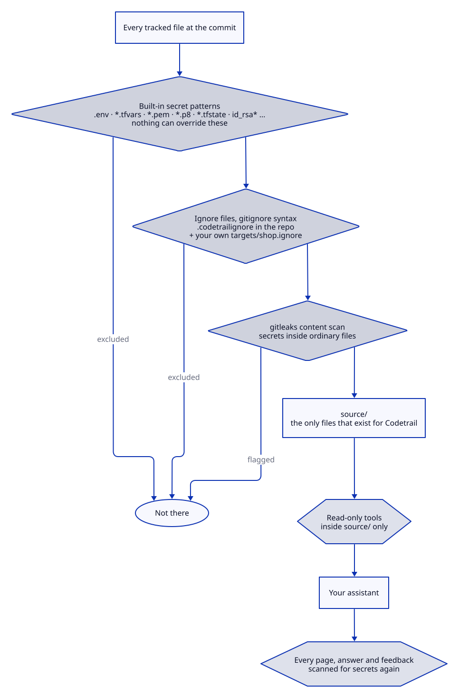

An excluded file is as if it weren't in the repository: it isn't extracted, readable by the assistant, shown in the page, or included in diffs, digests or the "you're behind" counts. Symlinks are never copied. `codetrail files <target>` shows exactly what's visible and what's hidden, and why.

**The local page is locked down too.** It listens on `127.0.0.1` only, checks `Host` and `Origin`, signs you in with a one-time code that becomes a strict session cookie, requires a per-session token on every write, renders Markdown with raw HTML disabled, sends a strict Content Security Policy, and tells the browser never to store its pages.

## Learning, and knowing when it went stale

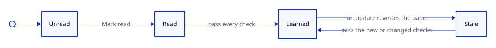

When a page you learned is rewritten, it shows a diff of what changed since you learned it, and only the new or changed checks need answering again. "Since you last caught up" lists the digests you haven't read, then the pages that went stale.

## Languages

The interface is English first and switches language from the page; it ships in English and Arabic (العربية), which reads right to left, keeps technical terms such as commit and branch in English, and writes numbers with Western digits. Each language is one gettext catalog (`src/codetrail/locales/<code>/LC_MESSAGES/codetrail.po`); adding a language means adding a catalog, with no code change: `uv run pybabel init -l <code> -i src/codetrail/locales/codetrail.pot -d src/codetrail/locales -D codetrail`, translate it, then run `just catalogs` and commit the catalog and its compiled `.mo` together, which every install reads. Right-to-left languages are supported. The page's own messages follow the language too; what the assistant's programs and the update's steps report stays in English, as the command line prints it. The guide's pages stay in English, because the sources and the quotes are in English; live answers and check feedback come back in the language you choose.

## Status

The latest release is Codetrail 1.4.1 ([release notes](docs/releases/v1.4.1.md), [changelog](CHANGELOG.md)); 1.0.0 was the first public release. Phases 0 to 15 and 17 to 20 of the [design](docs/design/2026-10-05-codetrail-design.md) are built, tested and released; Phase 16 is planned. Codetrail is on PyPI as `codetrail-cli` ([ADR 0019](docs/adr/0019-publish-to-pypi-as-codetrail-cli.md)).

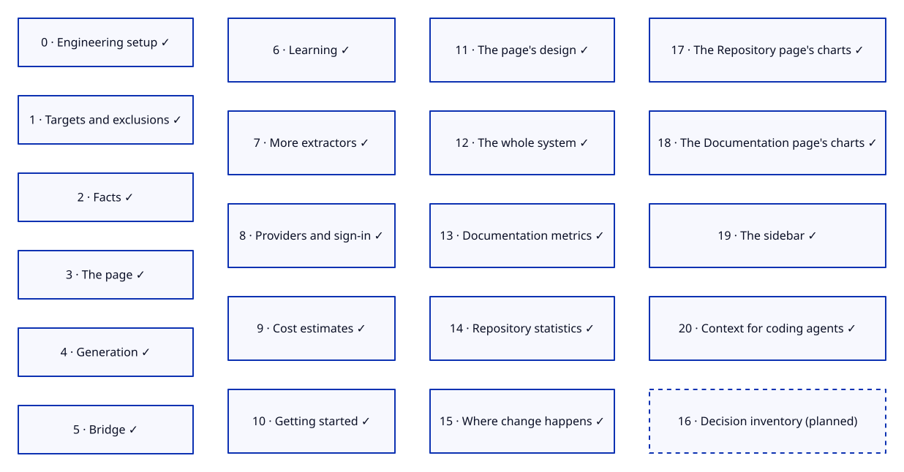

| Phase | What you can do | Status |
|---|---|---|
| 0. Engineering setup | `just ci` passes; the agent rules are enforced by hooks and permissions | Done |
| 1. Targets and exclusions | See exactly which committed files Codetrail can read, with secrets and your excluded files gone; remove a target and everything Codetrail kept for it | Done |
| 2. Facts | Modules, packages and decisions as facts | Done |
| 3. The page | A grounded map of the repository that says when it's behind, at no cost | Done |
| 4. Generation | The guide: digests, area and concept pages | Done |
| 5. Bridge | Ask from any page and save the answers | Done |
| 6. Learning | Paths, checks, progress and staleness | Done |
| 7. More extractors | OpenAPI, Terraform and Swift packages in the guide | Done |
| 8. Providers and sign-in | Claude Code, Codex or a local model, on your own subscription | Done |
| 9. Cost estimates | An estimate before every paid action | Done |
| 10. Getting started | This README, and the [getting-started guide](docs/getting-started.md) | Done |
| 11. The page's design | A new look with progress first, search, a command palette, shortcuts, an Ask panel, an update panel that shows each step of an update, and pages for progress, saved answers and digests; tested in a real browser | Done |
| 12. The whole system | Facts for TypeScript, JavaScript and Astro code, deploy evidence from GitHub Actions, and the system pass: a repository's services, apps, libraries, contracts and infrastructure, and how they connect (`codetrail update` prints the count per rule); the system diagram on its own page, on the home page and on area pages, which pages and answers can also place | Done |
| 13. Documentation metrics | The Documentation page, its home card and `codetrail metrics`: documented rationale by source, commits that explain why, ADR health, and facts a document mentions or the guide explains, with a trend per update | Done |
| 14. Repository statistics | The Repository page, its home card and `codetrail stats`: the branch's history and activity, releases from its tags, code size by language with the test share, and facts by kind with the dependencies that arrived and left, with a trend per update | Done |
| 15. Where change happens | On the Repository page: the most changed files, folders and guide areas beside each area's documented and inferred rationale, quiet code and commit size | Done |
| 17. The Repository page's charts | An interactive timeline with releases and dependency changes, a day-by-day activity calendar, a heat map of where change happens by area, folder or file, a grid of each area's commits by month, and charts for commit size, languages, commit types and facts | Done |
| 18. The Documentation page's charts | The Documentation page as an overview beside folding sections: each metric's bar and trend, a chart in each section, the section most in need open first, and the long lists filtered by kind | Done |
| 19. The sidebar | Hide the sidebar and peek at it from the window's edge, fold its sections, and pin pages as tiles at the top; the page sits in a card inside a tinted frame | Done |
| 20. Context for coding agents | A map and a brief per page for coding agents, exported on every update and served by `codetrail mcp` to Claude Code and Codex; `codetrail agents` prints how to connect them | Done |
| 16. Decision inventory | An opt-in paid pass that lists the decisions in the code and looks for a documented "why" for each ([design section 18.8](docs/design/2026-10-05-codetrail-design.md#188-delivery-and-later-work)) | Planned |

Codex and local models are tested against stand-ins and Codetrail's own tests; Claude Code is also tested live. Codex's provider decision is [ADR 0006](docs/adr/0006-assistant-providers-and-subscriptions.md).

## Developing Codetrail

Python with uv, FastAPI, SQLite, tree-sitter and httpx. mise pins the tools (their checksums in `mise.lock`), `just` runs everything, lefthook runs the git hooks, commits follow Conventional Commits with a *Why* in every body, and branches follow git-flow with local-only finishes.

- **Test first.** Every behaviour starts as a failing test, including what must be refused: excluded files, rejected requests, tools an assistant may not use.
- **Coding agents never push**, never touch credentials and never write to a target repository. The full rules are in [AGENTS.md](AGENTS.md).

Once per clone:

```bash
mise trust && mise install
```

```bash
just setup
```

`mise install` puts gitleaks behind a mise shim pinned to this repository, so a Codetrail started from another folder finds no version there and says so: set one globally with `mise use -g gitleaks`, or set `[tools] gitleaks` in `~/.config/codetrail/config.toml` to the path `mise which gitleaks` prints.

Then `just ci` runs every check CI runs; `just lint`, `just format`, `just typecheck`, `just test` (every test but the live and browser ones, in parallel), `just test-quick` (the unit, API and hook tests in parallel, run by the pre-push hook), `just test-browser` (the page in headless Chromium, which `just setup` installs, in parallel) and `just test-live` (the real providers installed here, local only) run one kind each. The maintainer releases with `just release <version>` ([Releasing](CONTRIBUTING.md#releasing)). Each phase's implementation plan is in [docs/design/plans/](docs/design/plans/).

## Documentation

| Document | What's in it |
|---|---|
| [Getting started](docs/getting-started.md) | Install, connect an assistant, add a repository, build and read the guide |
| [Changelog](CHANGELOG.md) | What changed in each release; release notes for [1.4.1](docs/releases/v1.4.1.md), [1.4.0](docs/releases/v1.4.0.md), [1.3.0](docs/releases/v1.3.0.md), [1.2.0](docs/releases/v1.2.0.md), [1.1.1](docs/releases/v1.1.1.md), [1.1.0](docs/releases/v1.1.0.md), [1.0.1](docs/releases/v1.0.1.md) and [1.0.0](docs/releases/v1.0.0.md) |
| [Design](docs/design/2026-10-05-codetrail-design.md) | The whole system: architecture, exclusions, facts, generation, page and bridge, learning, providers and estimates, errors, testing, phases |
| [Brainstorm decisions](docs/design/brainstorm-decisions.md) | The problem, every early decision and why |
| [Architecture decision records](docs/adr/README.md) | Decisions that are hard to reverse |
| [Security review checklist](docs/security/review-checklist.md) | What every change is reviewed against |
| [AGENTS.md](AGENTS.md) | Rules and workflow for coding agents |
| [Contributing](CONTRIBUTING.md) | The rules for contributing: git-flow, pull requests, simple code, tests first, commits, releasing, and the licence of contributions |
| [Security policy](SECURITY.md) | How to report a vulnerability privately, and what counts as one |
| [Trademarks](TRADEMARKS.md) | What you may do with the name and logo |

## Credits

- The page's typeface is [Inter](https://rsms.me/inter/) by Rasmus Andersson, under the SIL Open Font License 1.1 ([its licence](src/codetrail/web/static/vendor/inter/LICENSE.txt), [ADR 0007](docs/adr/0007-bundle-the-inter-typeface.md)). Arabic text is set in [Noto Sans Arabic](https://github.com/notofonts/arabic) by the Noto Project Authors, under the same licence ([its licence](src/codetrail/web/static/vendor/noto-sans-arabic/OFL.txt), [ADR 0014](docs/adr/0014-bundle-noto-sans-arabic.md), proposed).
- Diagrams, on the page and in this README, are drawn by [D2](https://d2lang.com) by Terrastruct, under the Mozilla Public License 2.0; the page runs D2's WebAssembly build with Go's `wasm_exec.js`, under Go's BSD licence ([their licences](src/codetrail/web/static/vendor/d2/), [ADR 0016](docs/adr/0016-draw-diagrams-with-d2.md)), and laid out by [ELK](https://eclipse.dev/elk/) (elkjs), under the Eclipse Public License 2.0 ([ADR 0018](docs/adr/0018-lay-out-diagrams-with-elk.md), proposed).
- The browser tests check accessibility with [axe-core](https://github.com/dequelabs/axe-core) by Deque, under the Mozilla Public License 2.0; it is used by the tests only ([ADR 0008](docs/adr/0008-browser-tests-with-playwright.md)).

## License

Copyright © 2026 Mohamed Abdel Sattar.

Codetrail is open source under the [Apache License 2.0](LICENSE). You may use, change and share it, commercially or not, as long as you keep its copyright and licence notices and say which files you changed ([ADR 0012](docs/adr/0012-apache-2-license.md)). Versions 1.0.0 and 1.0.1 were released under the GNU AGPL 3.0 only, and those copies keep that licence.

The licence grants no rights to the name "Codetrail" or its logo; [TRADEMARKS.md](TRADEMARKS.md) says what you may do with them. Contributions are welcome under the same licence; see [CONTRIBUTING.md](CONTRIBUTING.md).
