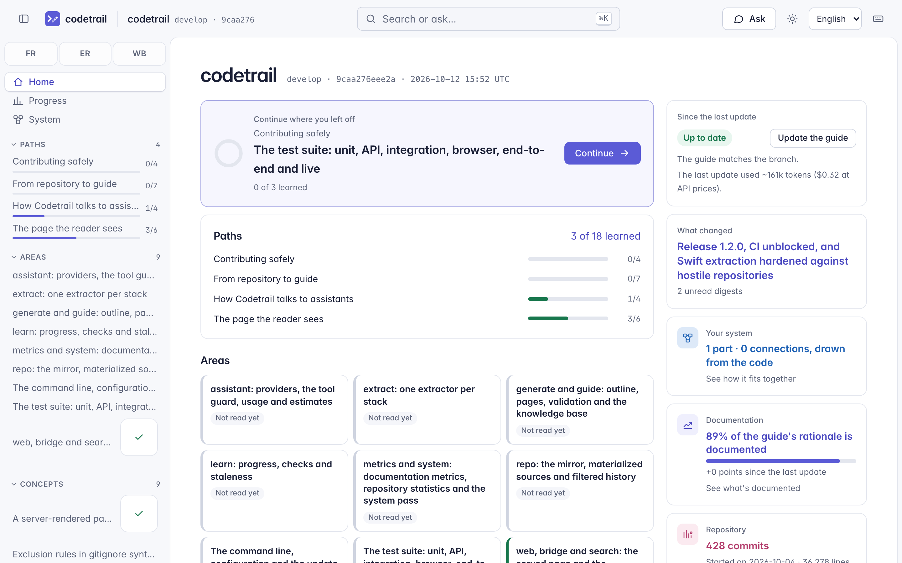
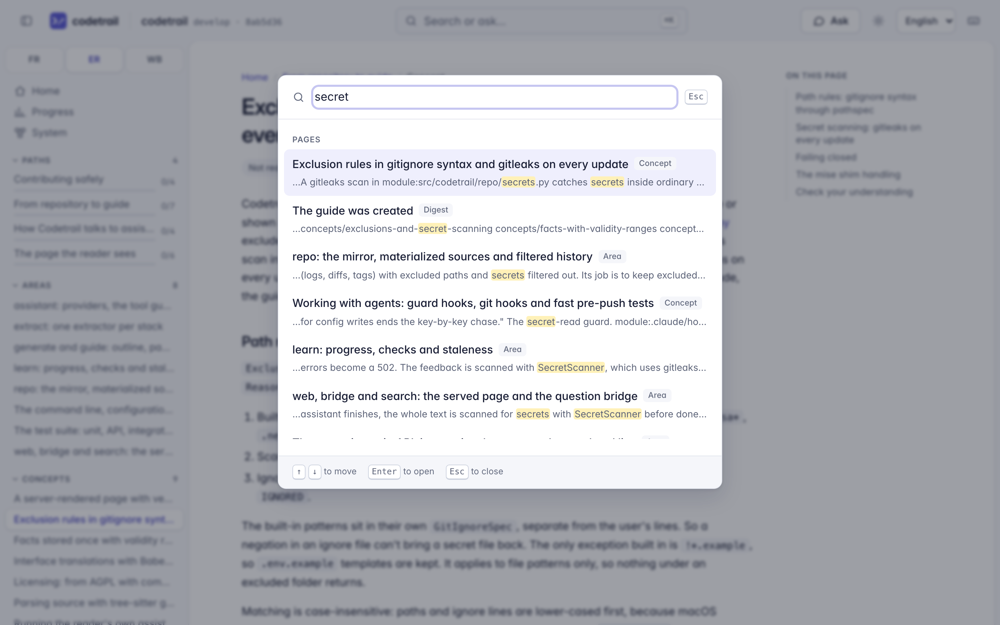

# Getting started

This guide takes you from nothing to a running Codetrail guide for one of your repositories: install it, connect an assistant, add the repository, build the guide, and open it in your browser. It takes about ten minutes, plus the time the first update runs.

Codetrail only reads your repository. It never writes to it, and everything it makes lives in its own folders.

## 1. What you need

- **macOS or Linux**, with **git**.
- **[uv](https://docs.astral.sh/uv/)**, which installs Codetrail and the Python it needs.
- **[gitleaks](https://github.com/gitleaks/gitleaks)** on your `PATH` (`brew install gitleaks`, a release binary, or `mise use -g gitleaks`; a mise shim works where mise sets a version), or its absolute path in `[tools] gitleaks` in `~/.config/codetrail/config.toml`. Codetrail refuses to read a repository without it, because it scans every file for secrets first.
- **One assistant**, with a subscription you already have. You can mix them later.

| Assistant | You need | Set it up |
|---|---|---|
| **Claude Code** (the default) | A Claude Pro or Max subscription | [Install Claude Code](https://code.claude.com/docs/en/setup), run `claude` once, and sign in with `/login` using your Claude account |
| **Codex** | A ChatGPT Plus or Pro subscription | `npm install -g @openai/codex`, then `codex login` and choose **Sign in with ChatGPT** |
| **A local model** | Nothing but your machine | [Ollama](https://ollama.com): `ollama pull qwen3:14b`, then `ollama serve`; or [LM Studio](https://lmstudio.ai)'s local server |

Codetrail runs your own signed-in `claude` or `codex` program and never sees your password, token or key. By default it removes every API key from the environment those programs get, so the work counts against your subscription and never bills an API account by surprise (section 7 covers choosing a key on purpose).

## 2. Install

```bash
uv tool install codetrail-cli
```

```bash
codetrail --version
```

Codetrail is on PyPI as `codetrail-cli`; the command is `codetrail`. PyPI's `codetrail` is an unrelated project, so always name `codetrail-cli`, and use `--from codetrail-cli` with `uvx`. `uv tool install` puts it on your `PATH`, and `uv tool upgrade codetrail-cli` installs a newer release. To try it without installing anything, run each command below as `uvx --from codetrail-cli codetrail …` instead. If you installed 1.4.0 or earlier, whose tool was named `codetrail`, run `uv tool uninstall codetrail` first: both put a `codetrail` command on your `PATH`. To run the code on `develop`, clone the repository and run `uv tool install .` in it.

## 3. Check your assistant

```bash
codetrail providers
```

You'll see each provider, whether it's installed and signed in, and how:

```
claude_code  ready      Claude subscription (max) · /Users/you/.local/bin/claude
codex        not ready
             Install Codex (`npm install -g @openai/codex`), then run `codex login` and choose Sign in with ChatGPT.
local        not ready  http://127.0.0.1:11434/v1
             Start Ollama (`ollama serve`) or LM Studio's server, or set [providers.local] base_url (http://127.0.0.1:11434/v1).
```

Only the providers you use need to be ready. Out of the box that's Claude Code.

## 4. Add a repository

```bash
codetrail target add shop ~/code/shop --branch main
```

`shop` is the short name you'll use from now on. Codetrail writes the target's settings to `~/.config/codetrail/targets/shop.toml`. Nothing is written into the repository.

## 5. See exactly what Codetrail can read

```bash
codetrail files shop
```

This lists every file Codetrail can see, then every file it hides and why. Codetrail reads only what is committed on the branch, so files git ignores and never committed don't exist for it. Some files are always hidden, whatever any setting says: `.env` files, Terraform variables, private keys and credential files, anything gitleaks flags, and every symlink. A file that was committed anyway, though `.gitignore` lists it, is visible unless one of those catches it, so list it in your ignore rules too. To hide more, add gitignore-style rules to `~/.config/codetrail/targets/shop.ignore`, or commit a `.codetrailignore` to the repository:

```gitignore
# never read the fixtures or anything under legacy/
tests/fixtures/
legacy/**
```

Run `codetrail files shop` again to check the result before any assistant reads a thing.

## 6. Build the guide

The facts (modules, packages, routes, infrastructure, decisions) cost nothing to extract:

```bash
codetrail update shop --facts-only
```

The guide itself is written by your assistant. Before any paid work, `codetrail update` refreshes the facts, works out the calls it would make, and asks:

```bash
codetrail update shop
```

```
This update will call:
  plan    claude_code · claude-opus-5-5: 1 call(s), ~68k tokens each (a starting guess), ~$0.40 each
  write   claude_code · claude-sonnet-5-5: 8 to 16 call(s), ~126k tokens each (a starting guess), ~$0.30 each
  digest  claude_code · claude-sonnet-5-5: 1 call(s), ~43k tokens each (a starting guess), ~$0.11 each
Expected: ~1.1M tokens (at most ~2.1M), ~$2.91 (at most $5.31) at API prices. The update stops at its budget of $10.00 or 5.0M tokens.
claude_code: Claude subscription (max), so no charge; the work counts against your plan's usage limits.
Continue? [y/N]
```

- **Dollars** are what the same work would cost at API prices. On a subscription you pay nothing extra; the work uses your plan's limits, and the estimate shows how much of each limit you've used once Claude Code has reported it.
- **A starting guess** marks an estimate made before Codetrail has a history of its own calls. After a few updates, estimates use the median of your own recent calls.
- **"At most"** counts every page being written twice (a failed check gets one retry), and is capped at the update's budget: each paid call reserves its cap (`max_budget_usd_per_call`, $1.00 by default) before it starts, so no call starts once the budget can't hold it, and a running call can pass its own cap only by its last turn. A local model reserves nothing. The update also stops at its token budget, whichever comes first.
- **A smaller first update:** the first update writes up to 20 pages. To keep it smaller, add this to `~/.config/codetrail/targets/shop.toml`:

  ```toml
  [generation]
  max_pages_per_update = 8
  ```

  The pages left out are written by later updates.

In a script, with no terminal to ask in, `codetrail update` prints the estimate, spends nothing and exits with code 2. Add `--yes` to go ahead without the question.

## 7. Open the page

```bash
codetrail serve shop
```

`serve` prints a one-time sign-in link and opens it in your browser. The page runs on `127.0.0.1` only, and the session ends when you stop `serve` (Ctrl-C). An update you started from the page stops with it, and the guide stays as it was before that update.



- **The home page** picks up where you left off: the next page of your current path, every path's progress and how much you've learned, and the areas, each marked learned, changed, read or not read yet. Beside them, a rail shows how far the guide is behind the branch (with what the last update used), what changed, the System, Documentation and Repository cards, your saved answers and the folders to browse.
- **The sidebar** lists the guided paths with your progress, the areas and concepts, your saved answers, the digests and the decisions. Each section folds from its heading. Pin the pages you use most with the pin on their row: they sit as tiles at the top, in any browser. Hide the sidebar with the button at the start of the header, or **\\**, and the page takes the whole width; rest the pointer on the window's edge to peek at it.
- **System** (in the sidebar, or **G** then **Y**) draws how the repository's parts connect: services, apps, libraries, contracts, infrastructure and where each runs. Solid arrows come from a file you can open; dashed ones were matched by name. Each area page shows the same diagram focused on its folder.
- **Documentation** (in the sidebar, or **G** then **O**) shows how well the repository explains itself: how much of the guide's rationale is documented and from where, which commits explain why, which ADRs need attention, and which dependencies no document mentions, each with the items behind it and a trend across updates. An overview beside the page shows each number with its bar and trend; each section opens to a chart and its items, the one most in need opens first, and the long lists filter by kind. It's free; `codetrail metrics shop` prints the same numbers. What counts as a document, and as a commit that explains why, is set per repository in `[metrics]` in its settings file.
- **Repository** (in the sidebar, or **G** then **T**) draws what the repository is: a timeline you can range over and pan (hover or focus a bar for its count, choose a release for its notes), a calendar of the last year day by day, and a heat map of where change happens that you can switch between guide areas, folders and files and click for details. Every number is also in a table under each chart. It shows when it started, its commits and activity month by month, its releases (the tags on the branch, with their notes), its lines of code by language and the share in tests, its facts by kind with the dependencies that arrived and left, and where change happens: the most changed files, folders and guide areas (beside how much of each area's rationale is documented), quiet code and commit size. It's free; `codetrail stats shop` prints the summary. What counts as a test, and how commit subjects are typed, is set per repository in `[metrics]` too (`test_globs`, `commit_type_pattern`).
- **Area and concept pages** explain one part of the repository, with a diagram drawn from the facts, quotes linked to their source lines, an "On this page" outline, and checks on your understanding. **Previous** and **Next** follow the path you came from.
- **Check my answer** grades your answer to a check. Each button shows its estimate, and afterwards what it used.

### Search, ask and save

- Press **⌘K** (Ctrl+K on Linux) or **/** anywhere to search the guide: pages, saved answers, decisions and facts. Search runs on your machine and costs nothing.
- Press **A**, or choose **Ask about** in the search box, to open the Ask panel beside the page you're reading. Your question goes with the page as context, and **Send** shows the estimate before anything is spent.
- The panel keeps this session's answers while you move between pages. **Save to guide** keeps an answer for good: it appears under **Saved answers** in the sidebar, on the Saved answers page, and in search.



### Shortcuts

Press **?** on any page to see them all.

| Keys | Does |
|---|---|
| **⌘K** or **/** | Search, or ask a question |
| **A** | Ask about this page |
| **G** then **H**, **P**, **Y**, **S**, **D**, **R**, **O**, **T** | Go home, to your progress, your system, saved answers, digests, decisions, documentation or the repository |
| **[** and **]** | Previous and next page in the path |
| **\\** | Hide or show the sidebar |
| **M** | Mark this page read, or unread |
| **U** | Update the guide (shows the estimate first) |
| **Esc** | Close the palette, the panel, the sidebar's peek or a dialog |

No shortcut spends anything: questions are sent by their **Send** button, and an update starts only when you choose **Go ahead**.

### Updating from the page

**Update the guide** (or **U**) refreshes the facts, then shows the update's estimate in a dialog. Nothing is spent until you choose **Go ahead**.

The theme follows your system; the sun button in the header switches between system, light and dark.

## 8. Choose assistants and models

Each kind of call (`plan`, `write`, `digest`, `answer`, `grade`) names its provider and model in the target's settings, as `provider:model`:

```toml
[models]
plan = "claude_code:claude-opus-5-5"
write = "claude_code:claude-sonnet-5-5"
digest = "claude_code:claude-sonnet-5-5"
answer = "local:qwen3:14b"          # questions answered by a model on your machine, free
grade = "claude_code:claude-sonnet-5-5"
```

To use Codex for a target, opt in first. Codex's sandbox stops writes but not reads, and its tools are shell commands. So Codex can read anything you can, including the files Codetrail hides (through Codetrail's own data folder) and your own keys, can run the repository's code inside its sandbox, and sends whatever it reads to OpenAI before Codetrail's scan sees it. Codetrail turns its web search off, and never uses it to grade a check or write a team's overview, which run with no tools at all. Use it only for repositories where that's acceptable:

```toml
[assistant]
allow_codex = true

[models]
write = "codex:gpt-5.5-codex"
```

Settings for all targets go in `~/.config/codetrail/config.toml`:

```toml
[providers.claude_code]
auth = "subscription"      # or "api_key": then ANTHROPIC_API_KEY is passed to claude, and you're billed by the API

[providers.local]
base_url = "http://127.0.0.1:1234/v1"   # LM Studio instead of Ollama; only addresses on this machine are allowed

[prices."gpt-5.5-codex"]               # USD per million tokens, for estimates of models Codetrail has no price for;
input = 1.25                           # placeholder values: copy the current ones from
output = 10.0                          # https://developers.openai.com/api/docs/pricing
```

The full list of settings is in [the design, section 9](design/2026-10-05-codetrail-design.md#9-configuration), and providers are covered in [section 15](design/2026-10-05-codetrail-design.md#15-assistant-providers-sign-in-and-cost-estimates).

## 9. Use Codetrail with your coding agents

Every update also writes context for coding agents to `~/.local/share/codetrail/shop/agents/`:
- a short map of the repository: its parts and how they connect, its decisions, recent changes and the guide's pages;
- a brief per area and concept page: its key files, its conventions and the reasons for them, marked documented or inferred as on the page.

An agent connected to Codetrail reads these before it starts a task, instead of rediscovering the repository each session. To connect one, run:

```bash
codetrail agents shop
```

It prints two commands, one for Claude Code and one for Codex, that register Codetrail's tool server with your own agent. Codetrail never runs them for you. Claude Code's is registered for your user, so it also works in the repository's worktrees, whose folders differ from the checkout's. When the agent starts, the server tells it which repository it covers, and to call `codetrail_map` before a task and `codetrail_brief` before changing an area. `codetrail_page` returns a whole guide page, and `codetrail_changes` the digests since a commit or a date.

The tool server only reads Codetrail's export. It listens on no port, runs no git and calls no assistant, so nothing an agent asks for costs a call. The briefs themselves come from the call that already writes each page, which the update's estimate includes. A brief whose page is out of date says so, and the map gives the `git diff` command that shows what changed since the guide's commit.

Without the tool server, an agent can still read the map at the start of every task: `codetrail agents` prints an import line for that. Put it only in an instruction file that isn't committed. Never put it in a committed `CLAUDE.md` or `AGENTS.md`, where a path in your home folder would reach everyone's history.

## 10. Keep up

Run `codetrail update shop` whenever the repository has moved on; the page's home says how far behind the guide is. Each update rewrites only the pages whose facts changed, learned pages first, and writes a digest of what changed and why.

## Following your team's repositories

If your team keeps its repositories on GitHub, Azure DevOps or GitLab, Codetrail can follow several of them at once, each with its own guide, behind one sign-in. Codetrail reads the service through the service's own program and your own git sign-in. It never reads, stores or passes a token, and it only reads from the service.

1. **Install the program and sign in.** For GitHub, install `gh` and run `gh auth login`. For Azure DevOps, install `az` and its extension (`az extension add --name azure-devops`), then run `az login`. For GitLab, install `glab` and run `glab auth login`. Only `gitlab.com` is supported.
2. **Let git use that sign-in.** Codetrail clones with your git, so git has to be able to read the repositories without asking. Run the command for your service yourself; Codetrail never does:
   - GitHub: `gh auth setup-git`.
   - GitLab: `glab auth login`, which offers to set up git.
   - Azure DevOps: install Git Credential Manager, or use an SSH key.

   If git can't fetch, the update fails and prints the command to run.
3. **Add the team.**

   ```bash
   codetrail team add acme
   ```

   This writes `~/.config/codetrail/teams/acme.toml` and opens the add-repositories screen. Pick a source: a GitHub organization or your own account, an Azure DevOps project, or a GitLab group. Once Azure DevOps is installed and signed in, a field appears where you type the organization, since `az` can't list them. Each service shows whether its program is installed and signed in, and if not, where to get it and the command to run.

   **Follow the whole source** is on by default. It follows the repositories pushed to in the last 90 days, so an organization of 600 repositories with 40 active ones gets 40. Untick a row to leave that repository out. Turn the switch off to pick repositories by hand. Archived, empty and disabled repositories are never followed. Azure DevOps reports no push time, so a whole Azure DevOps project follows all its enabled, non-empty repositories.

   **Add** then clones each repository, extracts its facts and builds the "you're behind" signal, naming each repository as it goes. This costs nothing. No guide is written yet: open a repository and use **Update the guide** to write its guide, with the estimate first. The list is read again afterwards, so what you added shows as followed.

   `codetrail team add` serves the team just as `codetrail team serve` does, and keeps serving it once the screen is done: the team page is at the same address, at `/`. Stop it with Ctrl-C.
4. **Serve it again later.** For every run after the first:

   ```bash
   codetrail team serve acme
   ```

   The team page lists each source, with how it's followed and how many repositories are left out, and each repository by its own name with its "you're behind" signal, how many merges landed since its guide was updated, and a link to its guide. A repository whose facts are read but whose guide isn't written yet says **No guide yet**, with a link to its guide's home, where **Update the guide** writes it. The team's pages share the guides' header (the theme switch and the language picker) and sidebar, which lists the team page, **Add repositories** and every followed repository. Each guide opens under `/repos/<name>/`, with all the pages of section 7 and **← Team** at the top of its sidebar, and one sign-in covers the team. `codetrail serve <name>` still serves one repository at a time, and its home page says which team it belongs to and how to serve the team.

   `team serve` lists your sources once when it starts, and gives each newly active repository the same free first refresh **Add** does. A page view writes no settings and lists no source: it may start serving a repository another command added, and it fetches each repository that already has a copy to read its signal, but it never clones one. Restart `team serve` to see repositories added or archived on the service.
5. **Update a guide.** Each repository is a normal target named `acme-<repository>`. Run `codetrail update acme-web-shop` as in section 6, or use **Update the guide** on that repository's pages. The estimate comes first, as always. Or catch all of them up at once, as the next step describes.
6. **Catch up.** Press **Catch up** at the top of the team page, or run `codetrail team update acme`. First the free part: Codetrail re-reads the sources, clones new repositories and refreshes every repository's facts. Then it shows one estimate, with a line and a checkbox for each repository (a new repository's first guide is marked as such) and a line for the overview when at least two ticked repositories can write a digest. The totals are capped at the team's budget, and unticking a repository recomputes them. **Go ahead** runs the ticked repositories, `catch_up.concurrency` at a time, within `catch_up.max_budget_usd`; a repository you left out keeps its free part, and its card says it wasn't caught up. Once the team's budget is spent, a repository whose turn hadn't come isn't updated, and its card and the panel say so; a card the last catch-up missed counts its merges from where its guide's newest digest ended. In the terminal, `codetrail team update acme` asks `Continue? [y/N]`, and `--yes` skips the question, as with `codetrail update`; it is all or nothing.

   When it finishes, the team page reads top to bottom:
   - **Since you last caught up**, how many repositories have new merges, and the **Catch up** button;
   - **Across the team**, an overview written from this catch-up's digests, until you mark it read;
   - one card per repository with something new, busiest first: its branch, merges and areas, the unread digest's highlights marked documented or inferred, **Merged by** (the authors' names as git records them, in alphabetical order and never counted), the digest's link and how many guide pages changed, with **Mark read** (which counts on the repository's own guide too). A dashed card says **Not caught up yet** when merges are waiting, and a card says why when its update failed or you left it out;
   - **Nothing new**, listing the quiet repositories, then the archived ones.

   The settings are `[team] highlights_per_digest` and `max_overview_words` in the global file, `[models] overview` (not Codex), `[catch_up] max_budget_usd`, `concurrency` and `max_budget_usd_per_call` (the overview call's limit, $1.00 by default) in the team's file, and `[estimates] overview`. Digests carry up to three highlights for every target.

`codetrail team list` shows each team with its sources and how many repositories it follows. `codetrail team remove acme` lists what it will delete (the team's settings and every target it created), asks first, and touches nothing on the service. It refuses while the team is served.

To leave a repository out, untick it on the add-repositories screen. That stops following it but keeps its data. To delete its data, stop `codetrail team serve` first (the running server holds every repository's lock, so the removal would be refused), then run `codetrail target remove acme-web-shop`.

A followed repository's branch is its default branch, and it can't be changed on the screen. A source's `clone_over` setting (`"https"` by default, or `"ssh"`) is in the team's file.

## Where things live

| Path | Holds |
|---|---|
| `~/.config/codetrail/` | Settings: `config.toml`, `targets/<name>.toml` and `.ignore`, and `teams/<name>.toml` |
| `~/.local/share/codetrail/<name>/` | A private copy of the repository's allowed files, the facts, the guide (its own git repository), and `agents/`, the context for coding agents |
| `~/.local/state/codetrail/<name>/` | Logs |

The `XDG_CONFIG_HOME`, `XDG_DATA_HOME` and `XDG_STATE_HOME` variables move these folders.

To remove one repository, run `codetrail target remove shop`; it refuses while `codetrail serve` or an update is using the target, so stop those first. It lists what it will delete (the target's settings, its ignore file, and its data and state folders), asks first, and never touches the repository itself. `--yes` skips the question.

To remove Codetrail, run `uv tool uninstall codetrail-cli` (`codetrail` for 1.4.0 and earlier) and delete those folders.

## Troubleshooting

| You see | Do this |
|---|---|
| No **System** link, or no facts for TypeScript, JavaScript or Astro code | A target's settings may list its extractors. Add `"typescript"` and `"github_actions"` to `extractors` in `~/.config/codetrail/targets/<name>.toml`, then run `codetrail update <name> --facts-only` (free). A repository with no projects, contracts or infrastructure has no parts to draw |
| `gitleaks wasn't found` | Install gitleaks and make sure it's on your `PATH`, or set `[tools] gitleaks` in `config.toml` |
| `… is a mise shim, and mise couldn't say which gitleaks it runs here` | The `gitleaks` on your `PATH` is a mise shim, and no mise configuration in the folder you ran Codetrail from (or a parent) sets a gitleaks version. Run Codetrail from such a folder, set a global version with `mise use -g gitleaks`, or set `[tools] gitleaks` in `config.toml` to the binary's absolute path (`mise which gitleaks` prints it) |
| `mise named … as gitleaks here, which isn't one of mise's own installs` | A mise configuration in the folder you ran Codetrail from names a gitleaks outside mise's installs (a `path:` version, perhaps from a repository you're reading), and Codetrail won't run it. Run Codetrail from another folder, or set `[tools] gitleaks` to a gitleaks you trust |
| `gitleaks didn't finish within … seconds ([tools] gitleaks_timeout_seconds)` | gitleaks was stopped before it finished scanning, and the update failed. For a large repository, raise `gitleaks_timeout_seconds` under `[tools]` in `config.toml` |
| `… is a mise shim, and mise didn't say which gitleaks it runs here within … seconds` | mise didn't answer in time, often because a mise configuration in the folder you ran Codetrail from runs a slow command. Check that folder's mise configuration, run Codetrail from another folder, or set `[tools] gitleaks` in `config.toml` to the binary's absolute path |
| `gitleaks failed (exit code …)` | The message ends with what gitleaks printed. To run a different gitleaks, set `[tools] gitleaks` in `config.toml` to its absolute path |
| `claude_code isn't ready. Run claude and sign in with /login` | Run `claude`, then `/login` with your Claude account |
| `Claude Code isn't signed in with a Claude subscription` | You signed in with an API (Console) account: `/login` again with your Claude account, or set `auth = "api_key"` on purpose |
| `local isn't ready` | Start `ollama serve` (or LM Studio's server) and pull a model |
| `update` exits with code 2 | There was no terminal to ask in; read the estimate it printed and add `--yes` |
| `Codex can read outside the repository's allowed files` | Add `[assistant] allow_codex = true` to the target, knowing Codex can read outside the allowed files |
