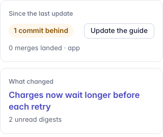
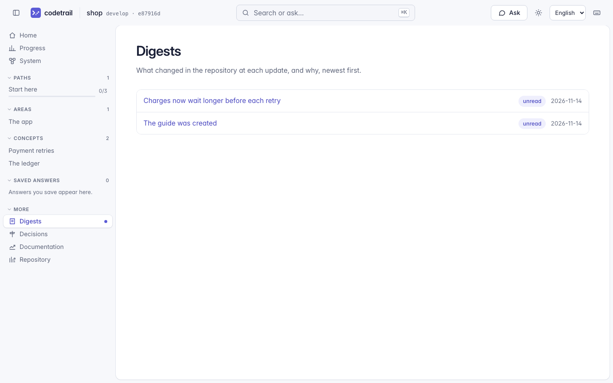
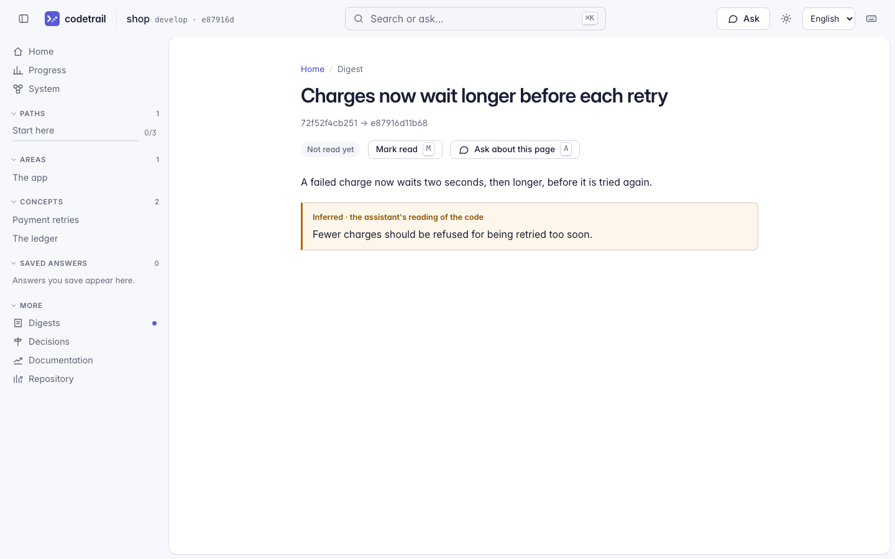

# Digests: what changed

A digest tells you what changed in the repository since the last update, and why. Each update writes one, so you can come back to a repository after a few weeks and read what you missed, newest first.

**Before you start:** build the guide with at least one update. See [Your first guide](first-guide.md). For how a digest gets written, see [Keeping the guide up to date](updating.md).

## See how far behind the guide is

The home page tells you whether the guide has caught up with the branch, and whether there is something to read.

1. Open the guide.
   ```bash
   codetrail serve shop
   ```
2. Look at the cards at the right of the home page.
   
3. Read **Since the last update**. The chip says one of:
   - **Up to date**, with "The guide matches the branch."
   - **N commits behind**, with how many merges landed and up to three areas they touched, for example "0 merges landed · app".
   - **No guide yet**, before the first update.
   - **…** with "An update is running.", or **—** with "Couldn't check for new commits just now."
4. Under the chip, the card shows what the last update used, in the form "The last update used ~N tokens ($X at API prices)."
5. Read **What changed**. It links to the newest unread digest and counts unread ones, for example "2 unread digests". When you have read them all it says "You're caught up." Before the first digest it says "No digest yet."

The count of commits behind is free. Codetrail fetches the branch and counts, and calls no assistant. It counts from the commit of the latest update, including one run with `--facts-only`. The result is cached for `[signal] cache_seconds` (60 by default).

To bring the guide up to date, choose **Update the guide** (or press **U**) and read the estimate, or run `codetrail update shop`. See [Keeping the guide up to date](updating.md).

## Open the list of digests

1. Choose **Digests** in the sidebar, or press **G** then **D**. A dot beside **Digests** means at least one is unread.
2. The **Digests** page lists every digest, newest first, with its date. Unread ones carry an **unread** mark.
   
3. Choose a digest to open it.

## Read a digest

1. Open a digest from the list or from the **What changed** card.
   
2. Under the title you see the two commits it spans, from the previous digest's end to this update's commit, each in its first 12 characters. The guide's first digest shows only its own commit.
3. Read the account of what changed and why. Each reason is marked as everywhere in the guide:
   - **Documented** quotes a source (a commit's *Why* section or a decision record) and links to it.
   - **Inferred** is "the assistant's reading of the code".
   See [Reading and learning](reading.md).
4. Follow the links to the pages the update changed.
5. Choose **Ask about this page** (or press **A**) to ask a question about the change. See [Search and ask](search-and-ask.md).

## Mark a digest read

1. Open an unread digest. Its status says **Not read yet**.
2. Choose **Mark read**, or press **M**.
3. The status becomes **Read**, the **unread** mark leaves the list, and the dot beside **Digests** and the **What changed** card move on to the next unread digest.

A digest has only this read mark. It has no checks, so it is never **Learned**. If your team uses a team page, **Mark read** on a card there marks the same digest read in the repository's own guide. See [Teams](teams.md).

## How digests are made

You don't write or schedule digests. They come from updates.

- Every update that finds new commits writes one digest, in the same run as the pages; so does the update that writes the guide's first pages. The update's estimate lists it as the `digest` call, with its model and cost. An update with no new commits writes none, and neither does `codetrail update shop --facts-only`, which calls no assistant.
- A digest covers the commits since the previous digest ended, even if an earlier update failed or wrote only facts.
- It is written from the commit log, the file changes and the change in facts. Commit messages and diffs are scanned for secrets first. A message or a file's patch that holds a finding is withheld.
- Like pages, a digest is checked before it is kept. If it contains something that looks like a secret, it fails like any invalid page, naming the rule only.
- It records each reason as documented or inferred, and which guide pages changed, with links.
- Each digest carries up to three highlights (`[team] highlights_per_digest`). They are the lines the team page shows on a repository's card.
- Digests are kept in the guide with the pages and are searchable with search.

## Settings

| Name | Default | What it does |
|---|---|---|
| `[models] digest` | `claude-sonnet-5-5` | The provider and model that write digests, as `provider:model` |
| `[estimates] digest` | `40000` input, `3500` output tokens | The starting guess for a digest call, used until Codetrail has history of its own |
| `[team] highlights_per_digest` | `3` (0 to 10) | Highlights each digest carries |
| `[signal] cache_seconds` | `60` | How long the "commits behind" count is reused |

## Costs

- **Free:** the home cards, the "commits behind" count, the Digests list and reading a digest.
- **Paid:** writing a digest, as part of an update. It appears in the update's estimate, which you see and confirm before anything is spent. See [Keeping the guide up to date](updating.md).

## Troubleshooting

| You see | What it means and what to do |
|---|---|
| Couldn't check for new commits just now. | Codetrail couldn't fetch the branch. Check that the repository is reachable by git, then reload. |
| An update is running. | The count waits until the update finishes. |
| No digest yet. | No update has found new commits. Run `codetrail update <name>`. |
| No digests yet | The same, on the Digests page: "Each update writes a digest of what changed since the last one." |

## See also

- [Keeping the guide up to date](updating.md)
- [Reading and learning](reading.md)
- [Teams](teams.md): catching up across several repositories
- [Coding agents](coding-agents.md): agents can read the digests too
