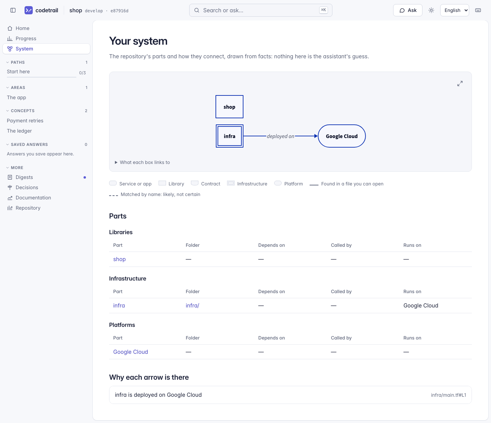
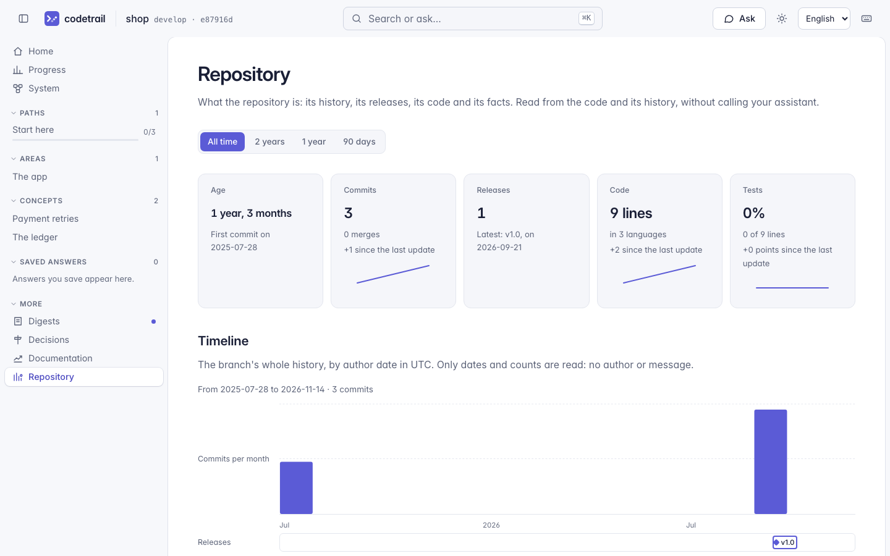
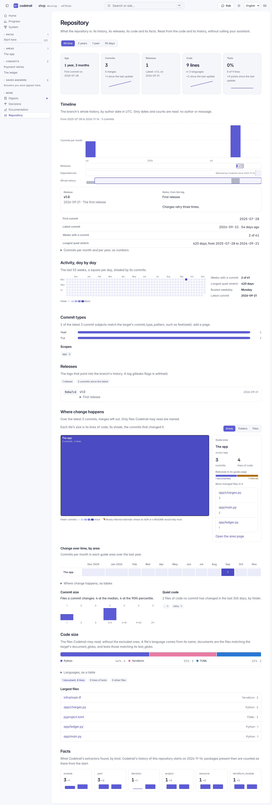
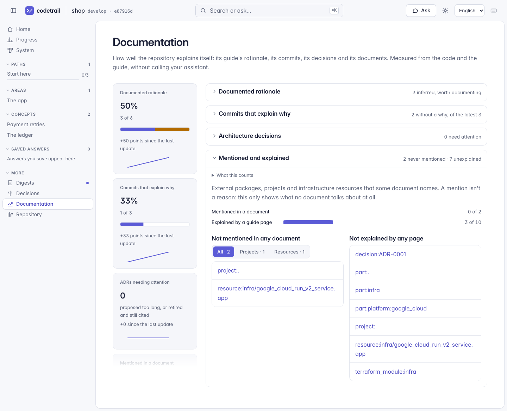
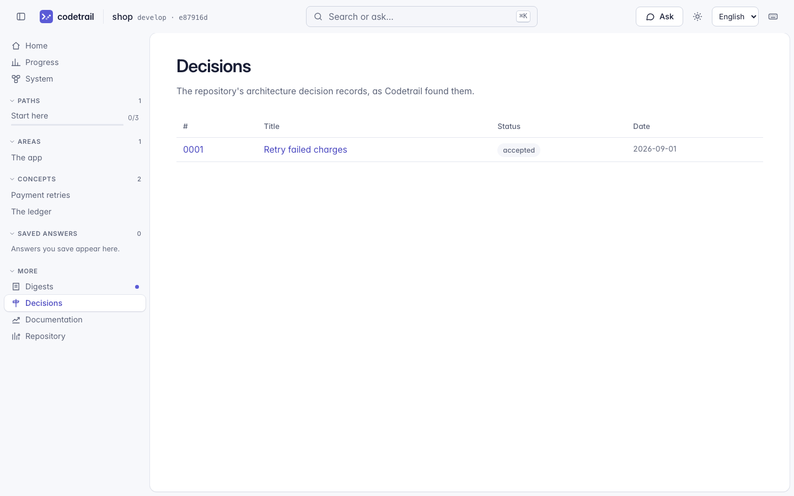
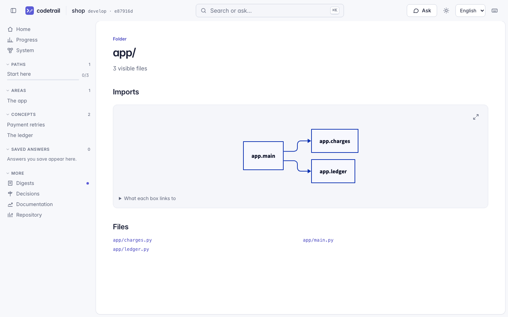
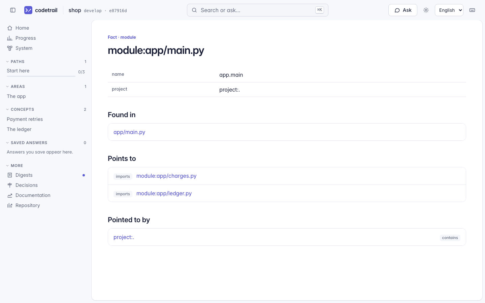
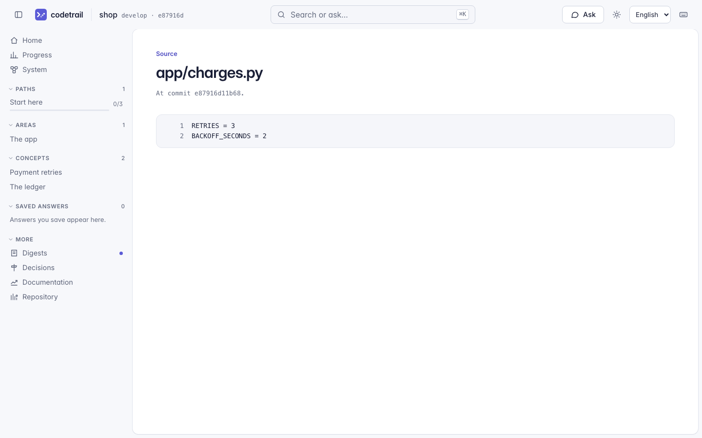

# Exploring the code

The guide's explanations sit on top of facts Codetrail extracted from the code. These pages let you look at the facts directly: how the parts of the system connect, what the repository's history looks like, how well it explains itself, its decisions, and its folders, facts and source files. All of them are free and none calls your assistant.

**Before you start:** the facts must be extracted. `codetrail update shop --facts-only` does it for nothing; a full update does it too. See [Your first guide](first-guide.md) and [What Codetrail reads](what-codetrail-reads.md). Codetrail shows only committed files, minus the ones it hides.

## See how the system fits together

The System page draws the repository's parts and how they connect, from facts: nothing on it is the assistant's guess.

1. Choose **System** in the sidebar, or press **G** then **Y**. The link is missing when the repository has no projects, contracts or infrastructure to draw (see [Troubleshooting](#troubleshooting)).
   
2. Read the diagram. Each box is a part. Its shape says what kind it is, as the legend under the diagram shows:
   - **Service or app**: a rounded box.
   - **Library**: a plain box.
   - **Contract**: a document shape.
   - **Infrastructure**: a double box.
   - **Platform**: a stadium shape.
3. Read the arrows. A **solid** line is **Found in a file you can open**. A **dashed** line is **Matched by name: likely, not certain**.
4. Choose the enlarge button at the top right of the diagram to see it larger. Open **What each box links to** for a list of links, one for each box.
5. Scroll to **Parts**. Parts are grouped as **Services**, **Apps**, **Libraries**, **Contracts**, **Infrastructure** and **Platforms**. Each table has the columns **Part**, **Folder**, **Depends on**, **Called by** and **Runs on**. Choose a part to open its fact page, or its folder to open the folder page.
6. Scroll to **Why each arrow is there**. Each line reads like "infra is deployed on a platform" and links to the file where Codetrail found it. The connections are **depends on**, **implements**, **calls through** and **is deployed on**. For a dashed arrow the line says "matched by name:" and shows the names that matched, with a link to the source.

When the repository has too many parts to draw one by one, the page says so: libraries, then folders, are grouped, with the number of connections on each arrow. Every part is still listed in the tables.

Each folder page shows the same diagram focused on its folder (**Where it fits**).

## Look at the repository's history and shape

The Repository page shows what the repository is, from the code and its git history. It does not call your assistant. The same numbers print in a terminal:

```bash
codetrail stats shop
```

1. Choose **Repository** in the sidebar, or press **G** then **T**.
2. Choose a range at the top: **All time**, **2 years**, **1 year** or **90 days**. The timeline follows it; the cards don't change.
   
3. Read the five cards: **Age** (with the date of the first commit), **Commits** (and how many were merges), **Releases** (and the latest), **Code** (lines and languages) and **Tests** (the share of lines in tests). **Commits**, **Code** and **Tests** also show their change since the last update.
4. Read the **Timeline**: commits per month by author date in UTC. Only dates and counts are read, never an author or a message. Hover or focus a bar for its count. Choose a release marker to see its notes, taken from the tag.
5. Scroll for the rest of the page:
   - **Activity, day by day**: the last 53 weeks, a square per day.
   - **Commit types** and **Scopes**: how recent commit subjects are typed.
   - **Releases**: the tags on the branch, with their notes.
   - **Where change happens**: a heat map. Switch between **Areas**, **Folders** and **Files**, and choose a tile for details. For an area, the details include how much of its rationale is documented.
   - **Change over time, by area**, **Commit size** and **Quiet code** (code no commit has changed for a year).
   - **Code size**: lines by language, the **Largest files**, and the split between documents, tests and other files.
   - **Facts**: what the extractors found, by kind, with what arrived and left.
   

Every number is also in a table under its chart: open lines such as **Commits per month and per year, as numbers**.

## See how well the repository explains itself

The Documentation page measures how much of the guide's reasoning is written down, and where. It is free. The same numbers print in a terminal:

```bash
codetrail metrics shop
```

1. Choose **Documentation** in the sidebar, or press **G** then **O**.
   
2. Read the overview cards on the left. Each shows a number, its bar and its trend over recent updates:
   - **Documented rationale**: the share of the guide's rationale blocks that are documented rather than inferred.
   - **Commits that explain why**: the share of the latest commits whose message gives a reason.
   - **ADRs needing attention**: decision records that need a look.
   - **Mentioned in a document**: external packages, projects and resources some document names.
3. Open a section on the right. The one most in need opens first.
   - **Documented rationale**: by source type (decision records, documents, code comments, commit messages) and by page, most inferred first. A long list folds into "N more".
   - **Commits that explain why**: the latest commits, merges left out, marked **Explain why**, **Body without a why** or **Subject only**. A commit explains why when its body matches `commit_why_pattern`.
   - **Architecture decisions**: records by status. A proposed record needs attention once it has waited too long, and a superseded or deprecated one while a guide page still cites it.
   - **Mentioned and explained**: which facts no document mentions, and which the guide does not explain.
4. Use the chips above a long list (for example **Projects** or **Resources**) to filter it by kind. Choose an item to open its fact page.

A trend needs at least two updates to compare. Before that the page says "No earlier update to compare with."

What counts as a document, as a commit that explains why, as a test and as a commit type is set per repository in `[metrics]` in its settings file.

## Read the repository's decisions

1. Choose **Decisions** in the sidebar, or press **G** then **R**.
   
2. Each row shows the number, the title, the status and the date of one architecture decision record.
3. Choose the number to open the record's fact page, or the title to open the record's file.

If you see **No decisions found**, Codetrail looks for records where `[adr] paths` points. The default is `docs/adr/*.md`. Change it in the target's settings file if your records live elsewhere, then run `codetrail update shop --facts-only`.

## Browse folders, facts and source files

1. On the home page, choose a folder under **Browse the code**. Or choose a part's folder on the System page.
2. A folder page shows **Where it fits** (the system diagram focused on the folder), **Dependencies of** each project in it, **Imports**, **Decisions** about it and its **Files**.
   
3. Choose a name in a diagram or a table to open its fact page. A fact page shows the fact's attributes, **Found in** (the files and lines that prove it), **Points to** and **Pointed to by**.
   
4. Choose a file path to open it in the source view. The view shows the file at the commit the guide describes, with line numbers. Choose a line number to link to that line.
   

A file that isn't text, or is too large to show, says "This file isn't text, or is too large to show." Files Codetrail hides never appear here. See [What Codetrail reads](what-codetrail-reads.md).

## Settings

| Name | Default | What it does |
|---|---|---|
| `[adr] paths` (target) | `["docs/adr/*.md"]` | Where decision records live |
| `extractors` (target) | `python`, `adr`, `openapi`, `terraform`, `swift`, `typescript`, `github_actions` | Which extractors read the code. A target created by an older version may list fewer |
| `[metrics] document_globs` (target) | `README*`, `*.md`, `*.rst`, `*.adoc`, `*.txt`, `docs/**` | What counts as a document |
| `[metrics] commit_why_pattern` (target) | a line starting with `why` | What makes a commit message explain why |
| `[metrics] test_globs` (target) | `test/**`, `tests/**`, `**/test_*.py` and similar | What counts as a test |
| `[metrics] commit_type_pattern` (target) | a Conventional Commits subject | How commit subjects are typed |
| `[metrics] commit_window` | `200` | Latest non-merge commits the commit metric reads |
| `[metrics] proposed_adr_days` | `30` | A proposed record older than this needs attention |
| `[metrics] trend_updates` | `12` | Updates a trend line shows |
| `[metrics] max_listed` | `50` | Items a list shows before the rest fold |
| `[metrics] activity_months` | `24` | Months the activity bars show |
| `[metrics] largest_files` | `10` | Files listed by size |
| `[metrics] churn_window` | `500` | Latest commits the change heat map reads |
| `[metrics] quiet_days` | `365` | Code no commit changed for this long is quiet |
| `[metrics] folder_depth` | `2` | Folder levels the heat map groups by |
| `[metrics] heatmap_tiles` | `60` | Tiles a heat map level draws |
| `[diagrams] max_nodes` | `25` | Most boxes a diagram draws before it groups |

The `[metrics]` rows marked (target) go in `~/.config/codetrail/targets/<name>.toml`; the other `[metrics]` rows go in `~/.config/codetrail/config.toml`. See [Settings](settings.md).

## Troubleshooting

| You see | What it means and what to do |
|---|---|
| No **System** link, or no facts for TypeScript, JavaScript or Astro code | The target's settings may list its extractors. Add `"typescript"` and `"github_actions"` to `extractors`, then run `codetrail update <name> --facts-only` (free). A repository with no projects, contracts or infrastructure has no parts to draw. |
| No connections between the parts were found. | The parts have no recorded links. Nothing is wrong; the table still lists them. |
| No decisions found | See [Read the repository's decisions](#read-the-repositorys-decisions). |
| No facts yet | Run `codetrail update <name> --facts-only`. |
| The metrics aren't available just now | Codetrail couldn't read the target's data. The log says why. |
| Not available just now. | One section couldn't be computed, for example the commit history couldn't be read. The log says why. |
| No pages yet: the guide's rationale is measured once your assistant writes it. | The rationale metric needs written pages. Run a full update. |
| This file isn't text, or is too large to show. | The source view shows text files only. |

## See also

- [Reading and learning](reading.md): documented and inferred blocks
- [What Codetrail reads](what-codetrail-reads.md)
- [Digests](digests.md)
- [Settings](settings.md)
