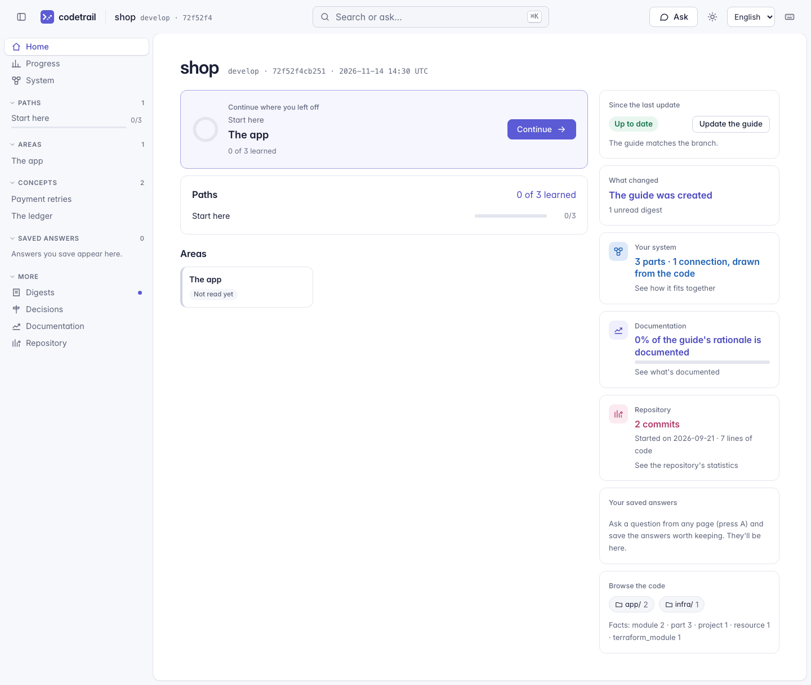
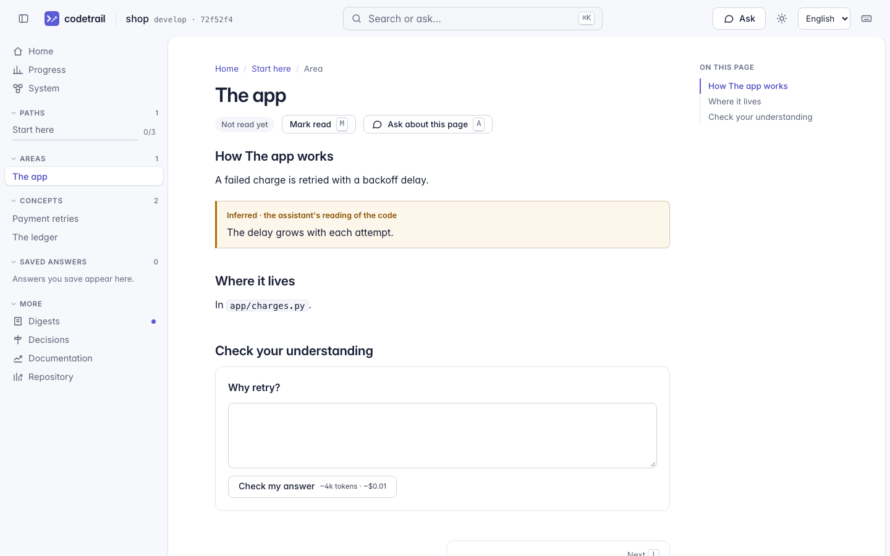
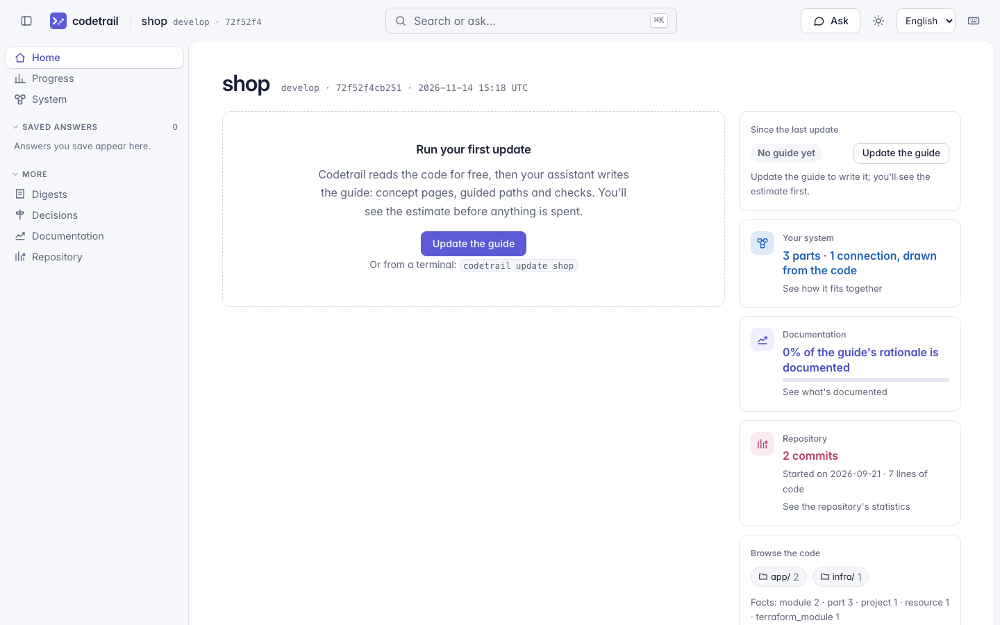
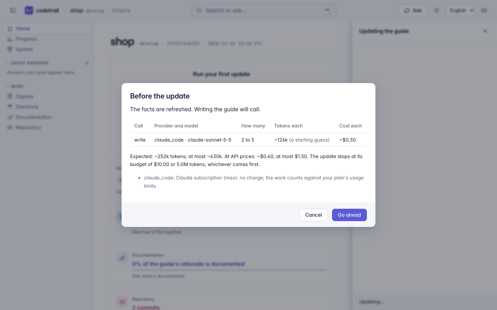
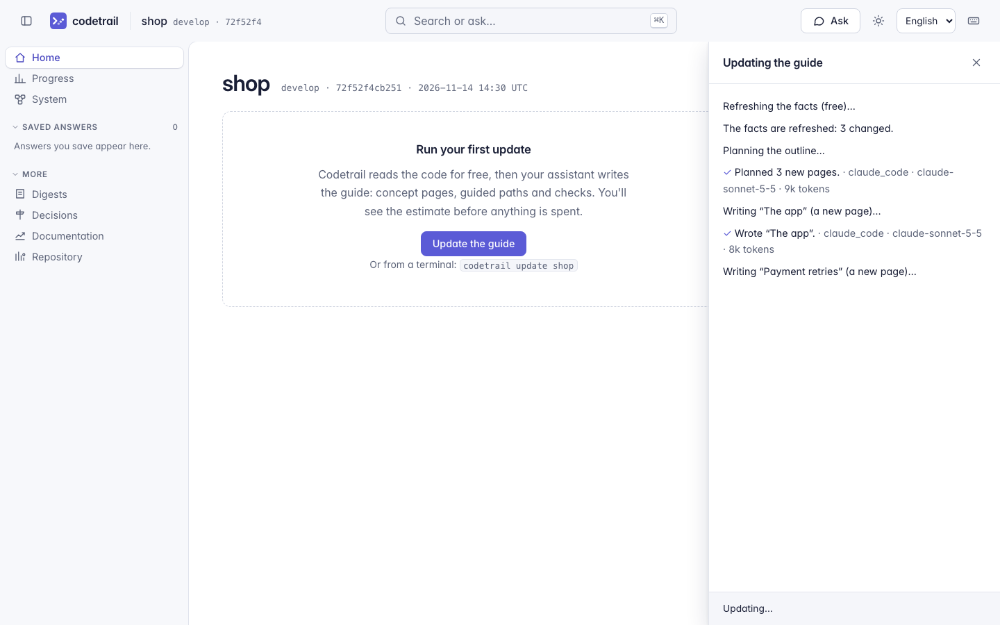

# Your first guide

This tutorial takes you from nothing to a Codetrail guide for one of your repositories, open in your browser. It takes about ten minutes, plus the time the first update runs.

Codetrail only reads your repository. It never writes to it, and everything it makes lives in its own folders.

**Before you start:** you need a git repository on your machine, and a subscription to an assistant (see step 1).

## Install Codetrail and check your assistant

1. Make sure you have what Codetrail needs:
   - macOS or Linux, with **git**.
   - **[uv](https://docs.astral.sh/uv/)**, which installs Codetrail and the Python it needs.
   - **[gitleaks](https://github.com/gitleaks/gitleaks)** on your `PATH` (for example `brew install gitleaks`). Codetrail refuses to read a repository without it, because it scans every file for secrets first.
   - One assistant, on a subscription you already have:

     | Assistant | You need | Set it up |
     |---|---|---|
     | **Claude Code** (the default) | A Claude Pro or Max subscription | [Install Claude Code](https://code.claude.com/docs/en/setup), run `claude` once, and sign in with `/login` using your Claude account |
     | **Codex** | A ChatGPT Plus or Pro subscription | `npm install -g @openai/codex`, then `codex login` and choose **Sign in with ChatGPT** |
     | **A local model** | Nothing but your machine | [Ollama](https://ollama.com): `ollama pull qwen3:14b`, then `ollama serve`; or [LM Studio](https://lmstudio.ai)'s local server |

2. Install Codetrail:

   ```bash
   uv tool install codetrail-cli
   ```

3. Check that it runs:

   ```bash
   codetrail --version
   ```

4. Check your assistant:

   ```bash
   codetrail providers
   ```

   You see one block for each assistant: whether it is installed and signed in, and how. For example:

   ```
   claude_code  ready      Claude subscription (max) · /usr/local/bin/claude
   codex        not ready
                Install Codex (`npm install -g @openai/codex`), then run `codex login` and choose Sign in with ChatGPT.
   local        not ready  http://127.0.0.1:11434/v1
                Start Ollama (`ollama serve`) or LM Studio's server, or set [providers.local] base_url (http://127.0.0.1:11434/v1).
   ```

   Only the assistants you use need to be `ready`. Out of the box that is Claude Code. A line that is `not ready` ends with the fix. The plan name and the path on the first line are yours; they differ from this example.

Codetrail runs your own signed-in `claude` or `codex` program and never sees your password, token or key. By default it removes every API key from the environment those programs get, so the work counts against your subscription and never bills an API account by surprise.

## Add your repository

1. Pick a short name (lower-case letters, digits and hyphens) and add the repository's folder. This example names it `shop`:

   ```bash
   codetrail target add shop ~/src/shop
   ```

   Codetrail teaches the `develop` branch unless you name another one. If your main branch is called `main`, add `--branch main`:

   ```bash
   codetrail target add shop ~/src/shop --branch main
   ```

2. Read what it printed:

   ```
   Added target 'shop': ~/src/shop (develop). Settings: ~/.config/codetrail/targets/shop.toml
   Exclusions you add go in ~/.config/codetrail/targets/shop.ignore (gitignore syntax).
   ```

   `shop` is the name you use in every command from now on. The settings file is Codetrail's own; nothing is written into the repository.

## See what Codetrail can read

1. List the files Codetrail can see and the files it hides:

   ```bash
   codetrail files shop
   ```

   ```
   app/charges.py
   app/main.py
   infra/main.tf
   pyproject.toml
   Excluded:
   4 visible, 0 excluded (none), commit 9e6a7cdf1390
   ```

   The first lines are the files the assistant may read. After `Excluded:` come the hidden files, each with the reason. The last line counts both.

2. If a file is hidden that you expected to see, or visible that you want hidden, read [What Codetrail reads](what-codetrail-reads.md). Run `codetrail files shop` again after any change. Nothing is sent to an assistant by this command.

## Build the guide

1. Read the facts out of the code first. This costs nothing:

   ```bash
   codetrail update shop --facts-only
   ```

   It prints how many entities and relations it found, and what changed since the last update.

2. Write the guide. Codetrail refreshes the facts again, works out which calls to your assistant it would make, shows the estimate and asks:

   ```bash
   codetrail update shop
   ```

   The estimate looks like this (your numbers differ):

   ```
   This update will call:
     plan    claude_code · claude-opus-5-5: 1 call(s), ~68k tokens each (a starting guess), ~$0.40 each
     write   claude_code · claude-sonnet-5-5: 8 to 16 call(s), ~126k tokens each (a starting guess), ~$0.30 each
     digest  claude_code · claude-sonnet-5-5: 1 call(s), ~43k tokens each (a starting guess), ~$0.11 each
   Expected: ~1.1M tokens (at most ~2.1M), ~$2.91 (at most $5.31) at API prices. The update stops at its budget of $10.00 or 5.0M tokens.
   claude_code: Claude subscription (max), so no charge; the work counts against your plan's usage limits.
   Continue? [y/N]
   ```

   The dollars are what the same work would cost at API prices. On a subscription you pay nothing extra; the work uses your plan's limits. [Keeping the guide up to date](updating.md) explains every part of the estimate.

3. Type `y` and press Enter to go ahead. Type anything else, or just press Enter, to stop. Nothing is spent unless you answer `y`.

4. Wait for it to finish. The last lines say how many pages were written:

   ```
   Guide: 3 pages written, 0 failed, 0 left for the next update; used ~... tokens, $... at API prices.
     Digest: digests/2026-11-14-9e6a7cdf1390
   ```

   The first update writes up to 20 pages. Pages left out are written by later updates; the line says how many wait.

## Open the page

1. Serve the guide:

   ```bash
   codetrail serve shop
   ```

   ```
   Codetrail is serving shop at http://127.0.0.1:8765/
   Sign in (this link works once, for a short time): http://127.0.0.1:8765/login?code=...
   ```

   Codetrail opens the sign-in link in your browser. If it can't, or you don't want it to, run `codetrail serve shop --no-browser` and open the link yourself. The link works once. The page runs on `127.0.0.1` only, so only your machine can reach it.

2. Look at the home page.

   

   The main column offers **Continue** to the next page of your current path, the paths with your progress, and the areas. The rail beside it shows **Since the last update**, here **Up to date**, and cards for what changed, your system, the documentation, the repository and the folders to browse. The sidebar lists the same sections.

3. Choose **Continue**, or a page in the sidebar, to read.

   

   A page explains one part of the repository. A note marked **Inferred** is the assistant's reading of the code; a note marked documented quotes its source. At the end is a check on your understanding.

4. When you are done, stop the server with Ctrl-C. The session ends with it.

[Reading and learning](reading.md) explains paths, pages, checks and progress.

## Or build the guide from the page

You can skip `codetrail update` and write the guide from the page instead. Serve the repository before its first update and you see this home page.

1. Run `codetrail serve shop`.

   

2. Choose **Update the guide**, in the middle of the page or in the rail. The page refreshes the facts and shows the estimate in a dialog.

   

3. Choose **Go ahead** to continue, or **Cancel** to stop. Nothing is spent until you choose **Go ahead**.

4. Watch the **Updating the guide** panel list each step as it finishes.

   

   When it ends, the foot of the panel says **Updated.** and the home page shows the guide.

## Settings

Everything in this tutorial works with the defaults. The settings you are most likely to change first:

| Setting | Default | What it does |
|---|---|---|
| `[generation] max_pages_per_update` (target file) | `20` | The most pages one update writes. Lower it for a smaller first guide. |
| `[tools] gitleaks` (`config.toml`) | `gitleaks` | The gitleaks program; set its absolute path if it isn't on your `PATH`. |
| `[server] port` (`config.toml`) | `8765` | The port `codetrail serve` listens on. |

All of them are in [Settings](settings.md).

## Costs

- Free: `codetrail providers`, `codetrail files`, `codetrail update --facts-only`, `codetrail serve`, searching and reading.
- Paid, on your assistant's subscription: writing the guide (`codetrail update` without `--facts-only`), asking a question and checking an answer.
- The estimate comes first every time: in the terminal before `Continue? [y/N]`, on the page before **Go ahead**, and beside the **Send** and **Check my answer** buttons.

## Troubleshooting

| You see | Do this |
|---|---|
| `gitleaks wasn't found` | Install gitleaks and put it on your `PATH`, or set `[tools] gitleaks` in `~/.config/codetrail/config.toml`. |
| `claude_code isn't ready. Run claude and sign in with /login …` | Run `claude`, then `/login` with your Claude account, then `codetrail providers`. |
| `… isn't a git repository (it has no .git).` | Give `codetrail target add` the folder that holds `.git`. |
| `… has no branch 'develop'.` | Add `--branch` with your branch's name. |
| `update` stops after the estimate and exits with code 2 | There was no terminal to ask in. Read the estimate and run again with `--yes`. |

More are in [Troubleshooting](troubleshooting.md).

## See also

- [What Codetrail reads](what-codetrail-reads.md)
- [Keeping the guide up to date](updating.md)
- [Reading and learning](reading.md)
- [Assistants](assistants.md), to use Codex or a local model
