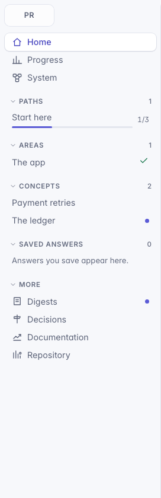
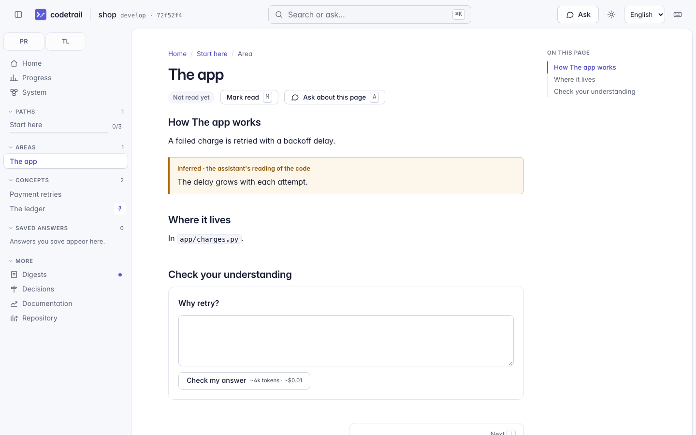
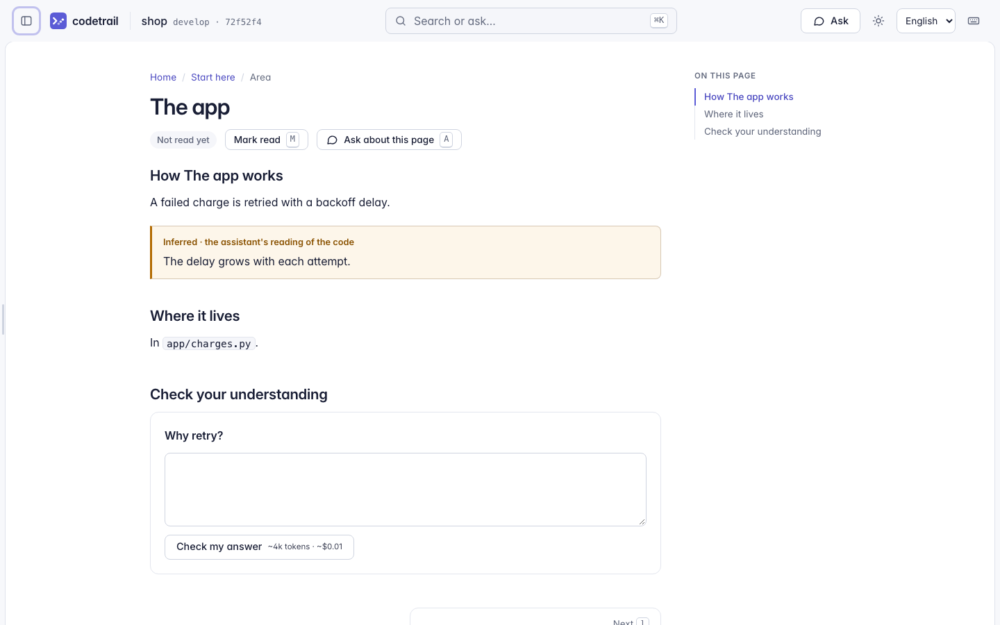
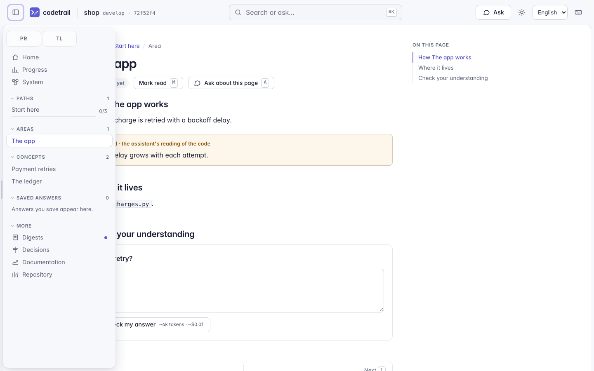
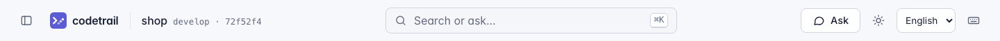
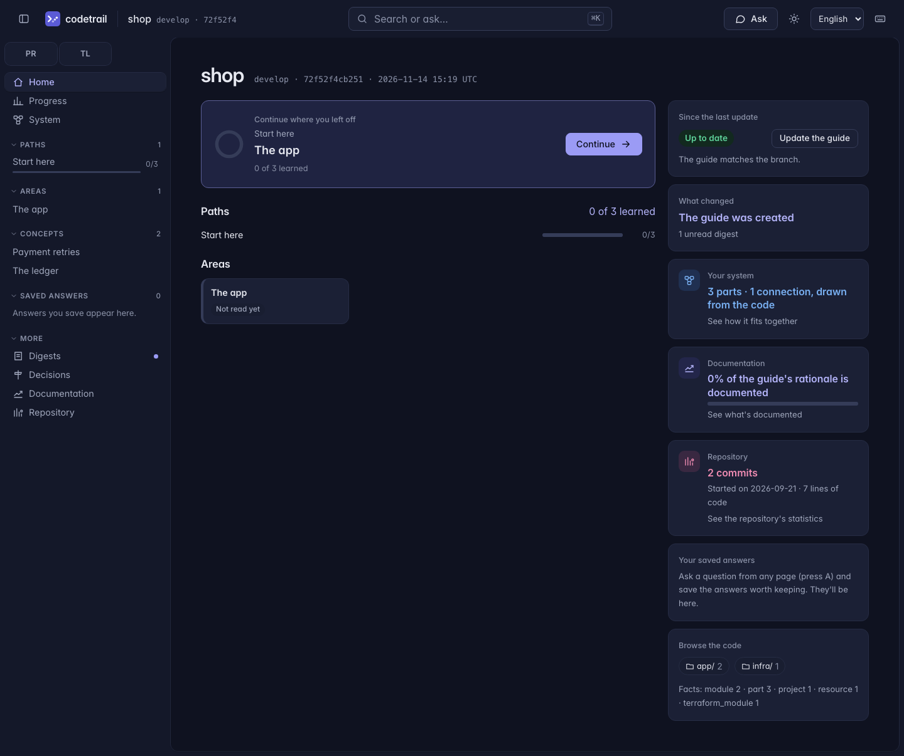
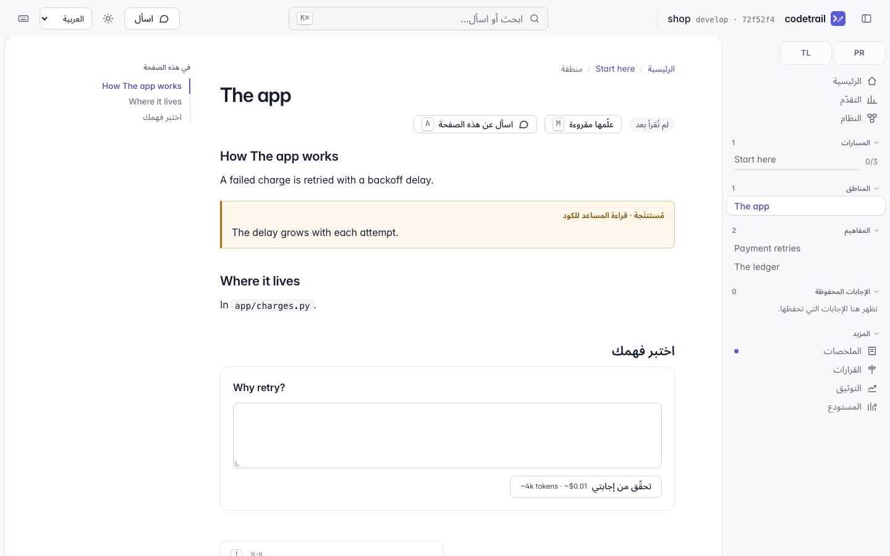
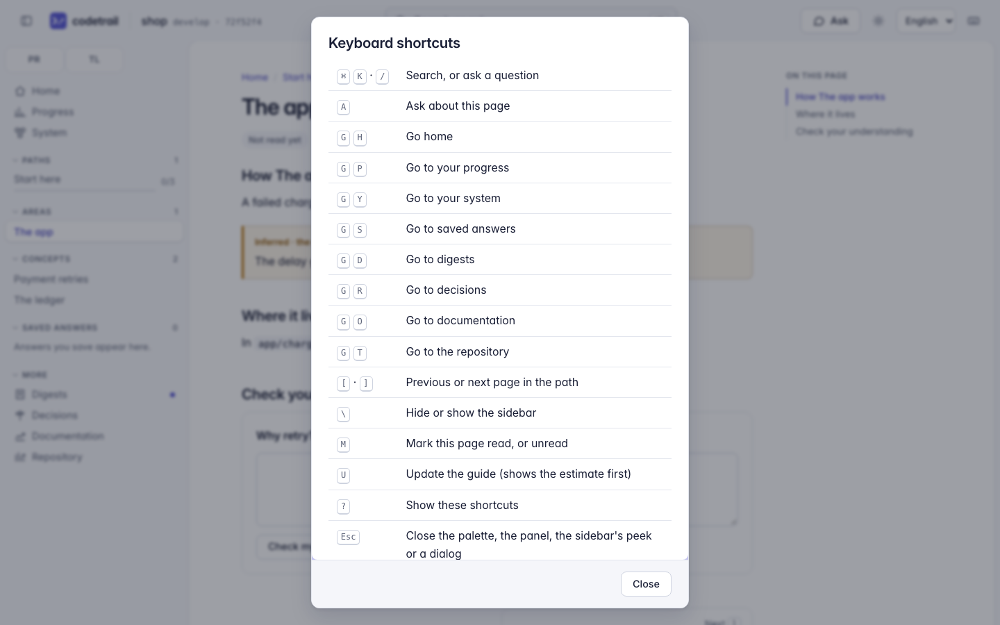
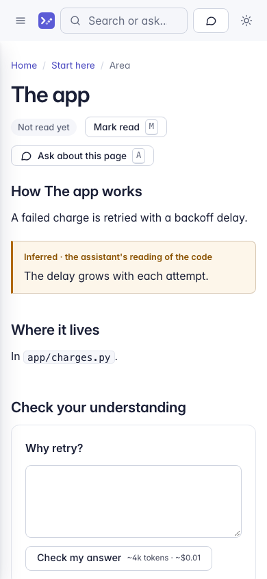
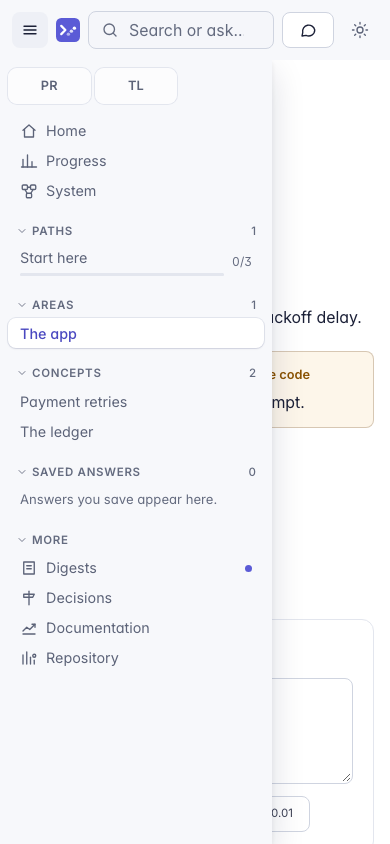

# Getting around the guide

This page covers the parts of the page that frame everything else: the sidebar, the header, the light and dark themes, the interface language, the keyboard shortcuts, and using the guide on a phone.

**Before you start:** have a guide open. See [Your first guide](first-guide.md). Nothing on this page spends anything.

## Use the sidebar

The sidebar lists the guide. From the top, it holds your pinned pages, **Home**, **Progress** and **System**, then these sections:

- **Paths**, each with a small bar and a count of pages learned.
- **Areas** and **Concepts**. A check beside a page means you have learned it; a dot means it changed since you learned it.
- **Saved answers**: the newest ones, then **All saved answers**.
- **More**: **Digests** (with a dot while one is unread), **Decisions**, **Documentation** and **Repository**.

### Fold a section

1. Choose a section's heading, for example **CONCEPTS**. The chevron turns and the list folds.
2. Choose the heading again to open it.

A folded section still shows the page you are on. Your choice is remembered in this browser.

### Pin the pages you use most

You can pin a path, an area, a concept or a saved answer.

1. Rest the pointer on its row in the sidebar. A small pin button appears at the end of the row (the label is **Pin** followed by the page's title).
2. Choose the pin. A tile appears at the top of the sidebar, showing up to two initials of the page's title. Rest the pointer on a tile to see the full title.
   
3. To unpin, rest the pointer on the tile and choose the small **x** on it, or choose the pin on the page's row again.

Pins are kept by Codetrail for this guide, so they follow you to any browser. You can pin up to 9 pages. At the limit the other pin buttons are turned off, and resting the pointer on one shows **Unpin a page first**.

### Hide the sidebar, and peek at it

1. Choose the button at the start of the header (**Hide the sidebar**), or press **\\**. The page takes the whole width. The choice is remembered in this browser.
   
2. To peek, rest the pointer on the left edge of the window for a moment. The sidebar slides out over the page.
   
3. It slides away shortly after the pointer leaves, when you follow a link in it, or when you press **Esc**.
4. To dock it again, choose the button in the header (now **Show the sidebar**) or press **\\**.

From the keyboard, the edge of the window is a button named **Show the sidebar for a moment**. Press **Enter** or **Space** on it to open the peek and move into the sidebar.

### Resize the sidebar

1. Drag the thin handle on the sidebar's inner edge, or focus it and press the arrow keys (16 pixels a step). **Home** and **End** go to the smallest and largest width.
2. Double-click the handle to reset it.

The sidebar stays between 200 and 420 pixels wide, and never takes more than 30% of the window or leaves the reading column narrower than 480 pixels. The width is remembered in this browser. The Ask panel has the same handle, between 320 and 720 pixels and at most 45% of the window.

## Use the header

From left to right:

- The sidebar button.
- **codetrail** and the repository's name, with its branch and the short form of the commit the guide describes.
- The search box, **Search or ask…** with the hint **⌘K**. It opens the search palette. See [Search and ask](search-and-ask.md).
- **Ask**, which opens the Ask panel.
- The theme button.
- The language picker.
- The keyboard button, which lists the shortcuts.

## Switch between light and dark

The theme follows your system until you choose.

1. Choose the sun button in the header. Each press moves to the next theme: system, light, then dark. Its label says what you have now and what the next press does, for example **Theme: system (switch to light)**.
2. You can also open the palette (**⌘K**, or **Ctrl+K** on Linux) and choose **Switch theme**.

The choice is remembered in this browser, for every guide.

## Change the language

1. Open the language picker in the header and choose a language. English is always available; other languages appear when their catalog is installed.
2. The interface changes at once. Your choice is saved for this guide.

The guide's own pages stay in English, and so do titles, file names and code. What changes is the interface: buttons, labels (the documented and inferred blocks' too), the grader's feedback and answers to your questions, which are written in the language you chose.

In a language written right to left, such as Arabic, the whole page mirrors: the sidebar sits on the right and peeks from the right edge.

## Use keyboard shortcuts

1. Press **?** on any page, or choose the keyboard button in the header, to list them.
   
2. Choose **Close** or press **Esc** to close it.

Single-key shortcuts are ignored while you are typing in a field, and when **⌘**, **Ctrl** or **Alt** is held. After **G**, press the second key within a second.

| Keys | Does |
|---|---|
| **⌘K** (**Ctrl+K** on Linux) or **/** | Search, or ask a question |
| **A** | Ask about this page |
| **G** then **H** | Go home |
| **G** then **P** | Go to your progress |
| **G** then **Y** | Go to your system |
| **G** then **S** | Go to saved answers |
| **G** then **D** | Go to digests |
| **G** then **R** | Go to decisions |
| **G** then **O** | Go to documentation |
| **G** then **T** | Go to the repository |
| **[** and **]** | Previous and next page in the path |
| **\\** | Hide or show the sidebar |
| **M** | Mark this page read, or unread |
| **U** | Update the guide (shows the estimate first) |
| **?** | Show these shortcuts |
| **Esc** | Close the palette, the panel, the sidebar's peek or a dialog |

No shortcut spends anything. **A** only opens the Ask panel: a question is sent with its **Send** button, which shows an estimate. **U** only opens the estimate dialog: an update starts when you choose **Go ahead**.

## Use the guide on a phone

On a narrow window (under 900 pixels) the page becomes a single column.

1. Make your browser window narrower than 900 pixels.
   
2. Choose the menu button at the start of the header. The sidebar opens as a drawer.
   
3. Choose a page. Press **Esc** or choose the menu button again to close the drawer.

On a narrow window the header keeps the menu button, the search box, **Ask** and the theme button. The repository's name, the language picker and the **⌘K** hint are hidden at 900 pixels and below. At 560 pixels and below, **codetrail** and the word **Ask** shrink to their icons and the keyboard button is hidden; press **?** for the shortcuts. Hiding and peeking at the sidebar do not apply, and the sidebar cannot be resized. Change the language in a wider window first, since your choice is saved for the guide.

The guide listens on `127.0.0.1` only, so a phone cannot reach it over the network. Use a narrow window on your computer to see this layout.

## Settings

| Name | Default | What it does |
|---|---|---|
| `[ui] max_pins` | `9` (1 to 50) | How many pages you can pin. Global setting |
| `[ui] default_language` | `en` | The interface language before you choose one |
| `[server] port` | `8765` (1024 to 65535) | The port the guide is served on, always on `127.0.0.1` |

## Troubleshooting

| You see | What it means and what to do |
|---|---|
| The pin buttons are turned off and say **Unpin a page first** | You have the most pages pinned that `max_pins` allows. Unpin one, or raise the setting. |
| The pin buttons don't appear | Pinning needs the page's script. Reload the page. Your existing tiles still work as links. |
| A shortcut does nothing | You are typing in a field, a dialog is open, or a modifier key is held. Press **Esc**, click on the page, and try again. |
| The theme or sidebar choice is not remembered | Your browser blocks site data (for example in a private window). The page still works, but forgets the choice on reload. |

## See also

- [Reading and learning](reading.md)
- [Search and ask](search-and-ask.md)
- [Settings](settings.md)
