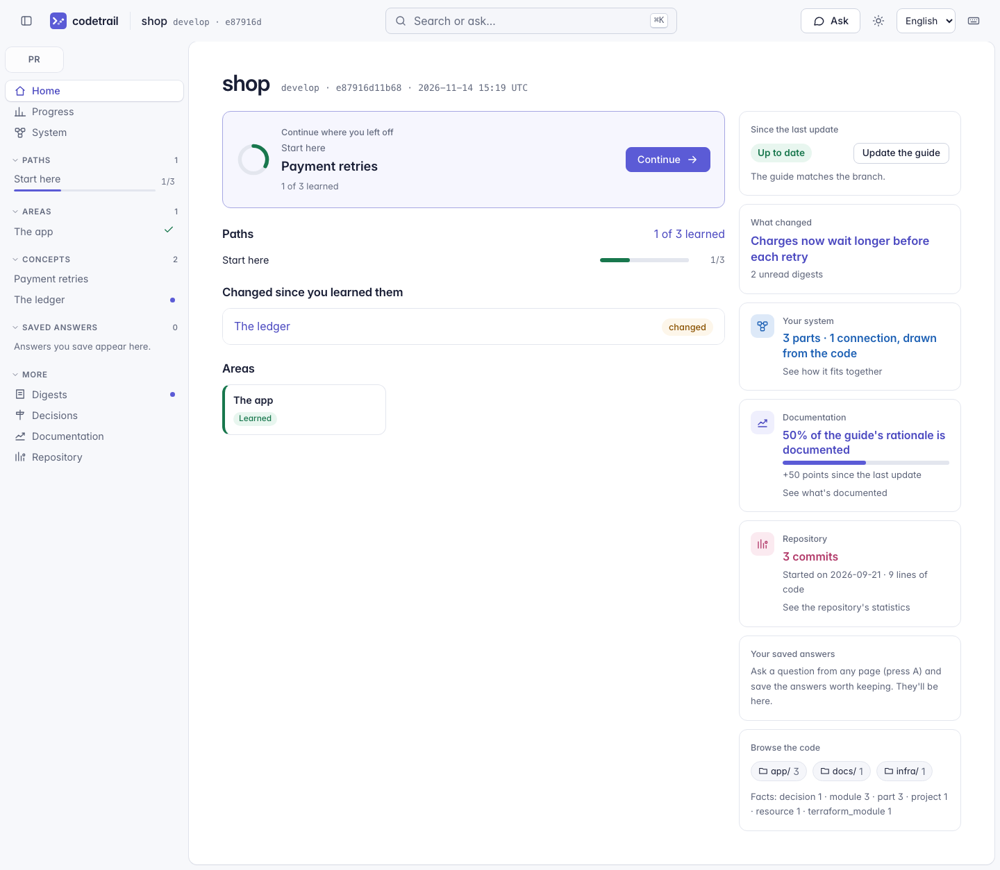
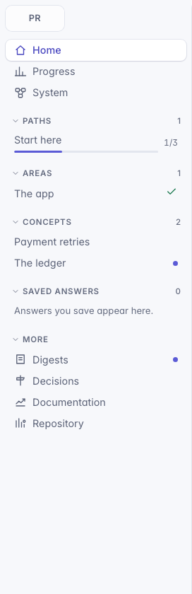
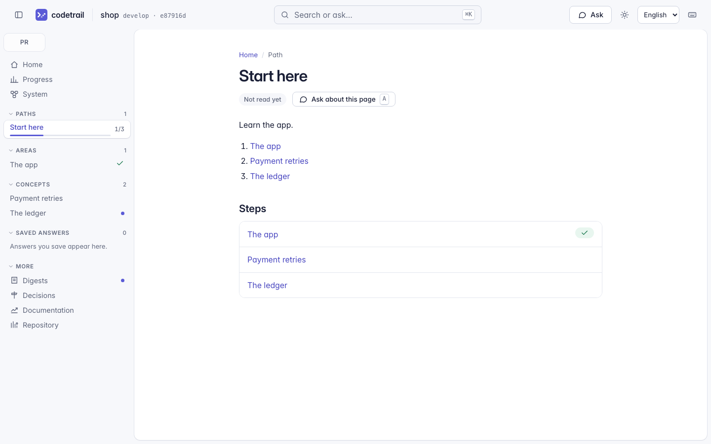
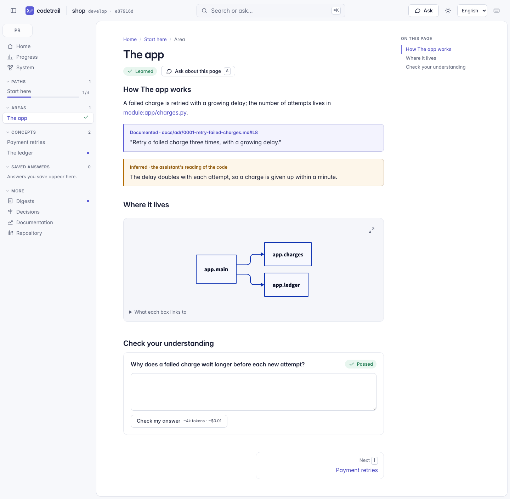
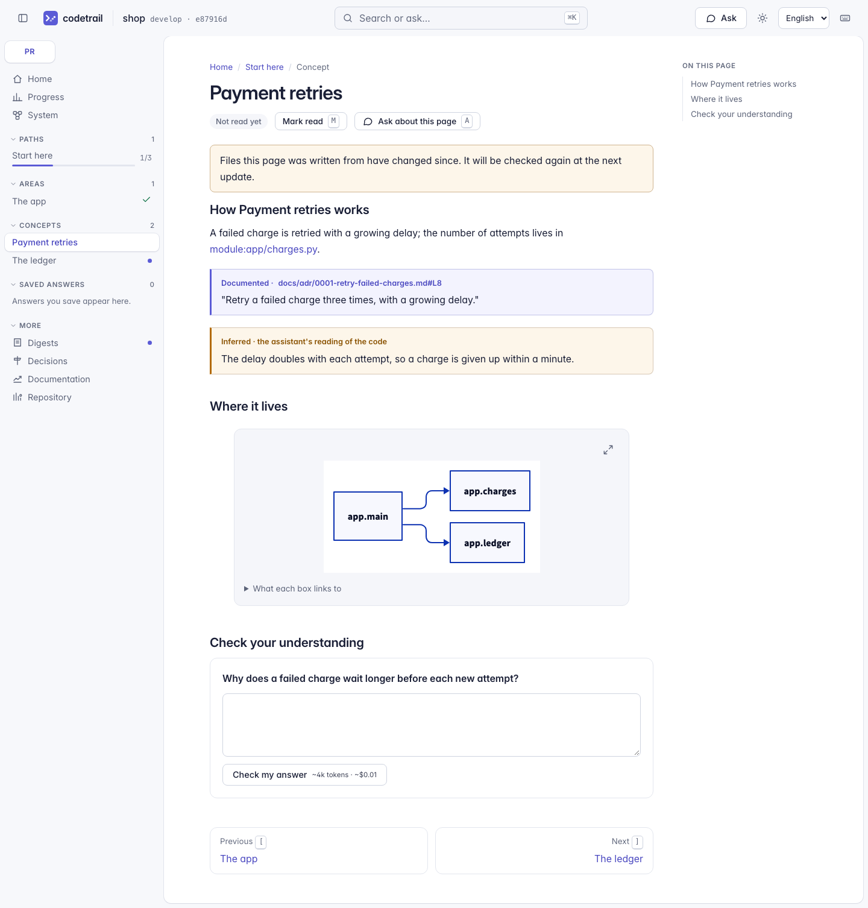
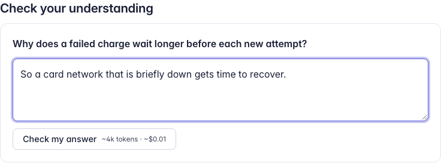
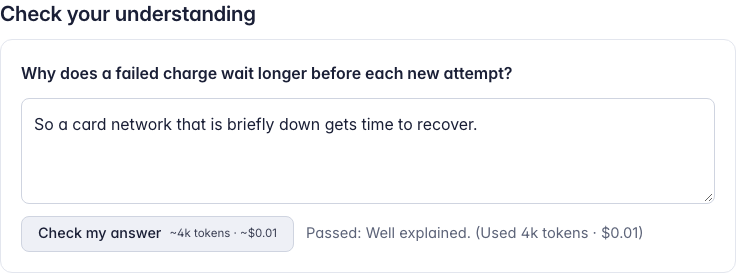
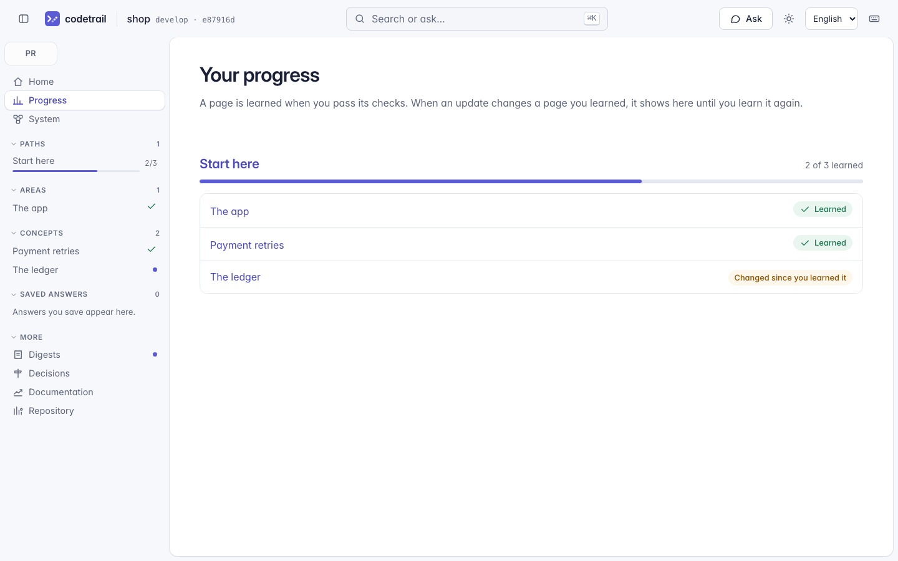
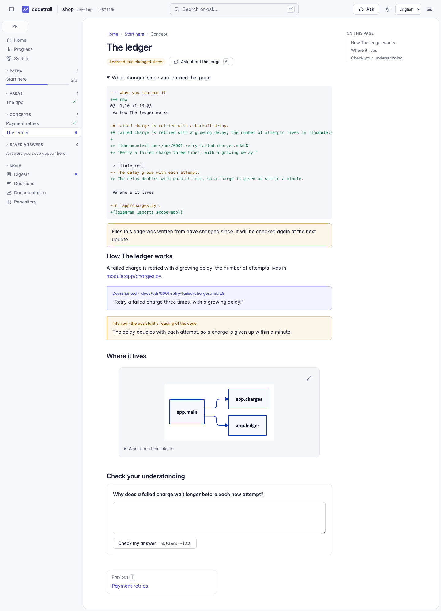

# Reading and learning

The guide is built to be read in order and checked as you go. This page covers the home page, guided paths, area and concept pages, the documented and inferred blocks, diagrams, marking a page read, the checks on your understanding, the Progress page, and what you see when an update changes a page you learned.

**Before you start:** build the guide and open it. See [Your first guide](first-guide.md). Everything on this page is free except **Check my answer**, which asks your assistant to grade an answer (see [Costs](#costs)).

## Pick up where you left off

1. Open the guide.
   ```bash
   codetrail serve shop
   ```
2. Look at the top of the home page. The card **Continue where you left off** names your current path, the next page you haven't learned and how many of the path's pages you have learned. A ring shows the same progress.
   
3. Choose **Continue** to open that page. The link carries the path with it, so **Previous** and **Next** at the bottom of the page follow that path.

Below the card, the home page lists:

- **Paths**, each with a bar and how many of its pages you have learned, and the total of pages learned across the guide.
- **Changed since you learned them**, if an update rewrote a page you had learned (see [When an update changes a page you learned](#when-an-update-changes-a-page-you-learned)).
- **Areas**, one tile per area, edged and labelled by state: **Learned**, **Changed**, **Read** or **Not read yet**.

When every path is learned, the card says **Every path learned**. Updates will tell you what changes.

## Follow a guided path

A path is a goal and an ordered list of pages.

1. In the sidebar, open a path under **Paths**. Each path shows a small bar and a count such as `1/3`.
   
2. Read the path's short introduction, then open the first page in **Steps**. A page you have learned shows a check beside it.
   
3. At the bottom of each page, use **Previous** and **Next** (or **[** and **]**) to move along the path.

A path page has no **Mark read** button. Its progress is the number of its pages you have learned.

## Read an area or a concept page

An area page explains one part of the repository. A concept page explains one idea that runs through it. Both have the same shape.

1. Open a page from the sidebar, from a path or from a tile on the home page.
   
2. Look under the title. The status says **Not read yet**, **Read**, **Learned**, or **Learned, but changed since**.
3. Use **On this page** at the right to jump between sections. It is hidden on windows 1200 pixels wide or narrower, and while the Ask panel is open.
4. Choose **Ask about this page** (or press **A**) to ask a question with this page as context. See [Search and ask](search-and-ask.md).

If the files a page was written from have changed since, the page says so: "Files this page was written from have changed since. It will be checked again at the next update." This notice does not take away a page you have learned.

### Documented and inferred blocks

Every reason the guide gives is marked.

- **Documented** (an indigo block) quotes a source and links to it, for example a decision record. When it cites a file, choose the link to open the source at that line. Codetrail checks that the quote is there.
- **Inferred** (an amber block) says "the assistant's reading of the code". It is a conclusion the assistant drew, not something written down. Treat it as a good lead and check it against the code.



### Diagrams

Diagrams are drawn from facts Codetrail extracted from the code, never by the assistant.

1. Choose the enlarge button at the top right of a diagram to see it larger.
2. Open **What each box links to** under the diagram to get a list of links, one for each box.

## Mark a page read

Marking a page read records that you have been through it. A page is only **Learned** when you pass its checks.

1. Open a page whose status is **Not read yet**.
2. Choose **Mark read**, or press **M**.
   
3. The page reloads with the status **Read**, and the button changes to **Mark unread**.
   

Choose **Mark unread** (or press **M** again) to take the mark back. This only works on a page that is read: a learned page stays learned.

## Check your understanding

Each area and concept page ends with two to four open questions under **Check your understanding**. You answer in your own words and your assistant grades the answer. The grading call uses the `grade` model from your settings.

1. Type your answer in the box under a question.
   
2. Read the estimate on the button, for example `~4k tokens · ~$0.01`. Nothing is spent until you choose the button.
3. Choose **Check my answer**.
4. Read the verdict beside the button. It is **Passed**, **Partly there** or **Not yet**, followed by feedback in the interface language and, in brackets, what the call used.
   
5. Answer again if you want to improve on **Partly there** or **Not yet**. Wait a few seconds between answers.

A question you passed shows **Passed** beside it. When every current check on a page has passed, the page becomes **Learned**, and the page reloads a moment later to show it.

The rubric the answer is graded against is never shown. Feedback that looks like it contains a secret is withheld and replaced by a message naming the rule.

## See your progress

1. Choose **Progress** in the sidebar, or press **G** then **P**.
   
2. Each path has a bar and "N of M learned", and lists its pages with their state: **Learned**, **Changed since you learned it**, **Read** or **Not read yet**.
3. Pages that belong to no path are listed under **Outside the paths**.
4. Choose any page to open it. A page opened from a path keeps that path for **Previous** and **Next**.

## When an update changes a page you learned

An update that rewrites a page you had learned does not erase what you learned. The page becomes **Learned, but changed since**.

1. Look for the signs: the page's amber status, a dot beside it in the sidebar, **changed** in the list **Changed since you learned them** on the home page, and **Changed since you learned it** on Progress.
2. Open the page. **What changed since you learned this page** is open at the top. It is a diff: lines starting with `+` were added and lines starting with `-` were removed, compared with the page as it was when you learned it.
   
3. Read the changes, then look at the checks. A check that did not change stays passed. Answer the new or changed ones to make the page **Learned** again.

## Settings

| Name | Default | What it does |
|---|---|---|
| `[learn] grading_cooldown_seconds` | `10` | Seconds you must wait between two graded answers |
| `[learn] max_budget_usd` | `0.25` | Spending limit for a grading call |
| `[models] grade` | `claude-sonnet-5-5` | The provider and model that grade your answers, as `provider:model` (for example `local:qwen3:14b`) |
| `[estimates] grade` | `4000` input, `500` output tokens | The starting guess for a grading call, used until Codetrail has a history of its own |
| `[estimates] history_size` | `20` | How many of your own recent calls estimates are based on |

Settings for one repository go in `~/.config/codetrail/targets/<name>.toml`. See [Settings](settings.md) for where each one lives.

## Costs

- **Free:** the home page, paths, pages, diagrams, marking pages read, Progress and the diff of what changed.
- **Paid:** each **Check my answer** is one assistant call. Its estimate is on the button before you choose it, and what it used is shown after. On a Claude or ChatGPT subscription there is no extra charge: the work counts against your plan's usage limits, and the dollar figure is what the same work would cost at API prices. A local model is free.

## Troubleshooting

| You see | What it means and what to do |
|---|---|
| Wait a few seconds before the next answer. | Two answers were sent too close together (`grading_cooldown_seconds`). Wait and choose the button again. |
| Another answer is being graded. | Only one answer is graded at a time. Wait for the first verdict. |
| Answers are limited to N characters. | Shorten your answer. |
| The grade couldn't be read, so nothing was recorded; try again. | The assistant's verdict was malformed. It is never counted as a pass. Choose the button again. |
| The answer couldn’t be graded. | The request failed without a reason. If the assistant's own error shows instead, follow it. Run `codetrail providers` to check that the assistant is ready, then try again. |
| The feedback was withheld: it contains something that looks like a secret (…). | The feedback was replaced because it matched a secret pattern. Your answer was still recorded. |
| A page you learned shows "Learned, but changed since" | An update rewrote it. Read the diff and answer the changed checks. |

## See also

- [Your first guide](first-guide.md)
- [Getting around](getting-around.md): the sidebar, shortcuts and the header
- [Search and ask](search-and-ask.md)
- [Digests](digests.md): what changed at each update
- [Keeping the guide up to date](updating.md)
- [Assistants](assistants.md): choosing the model that grades
