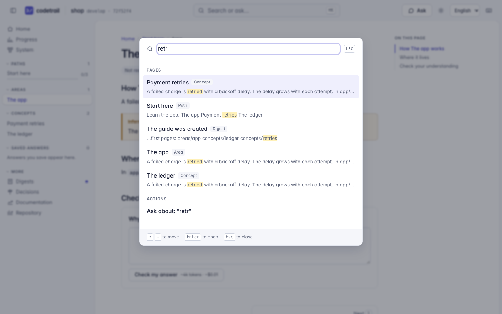
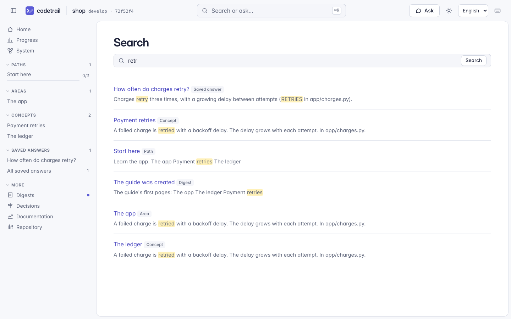
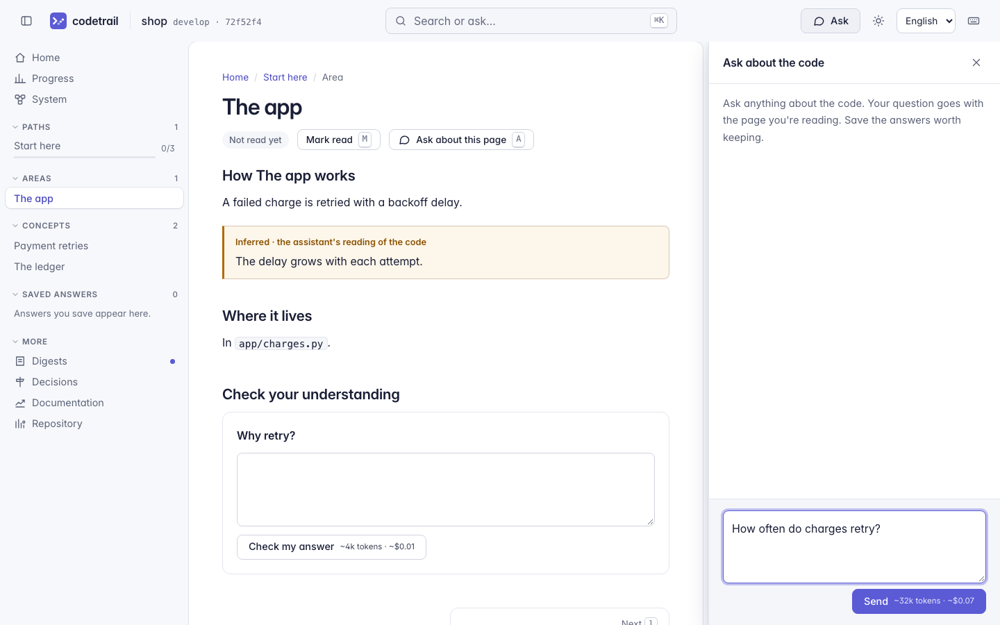
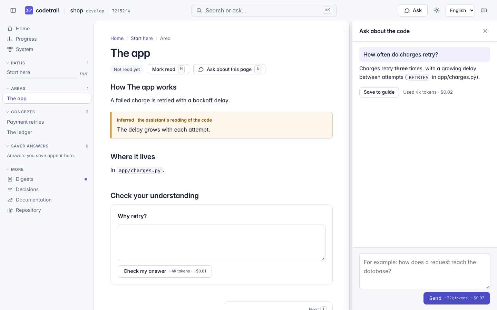
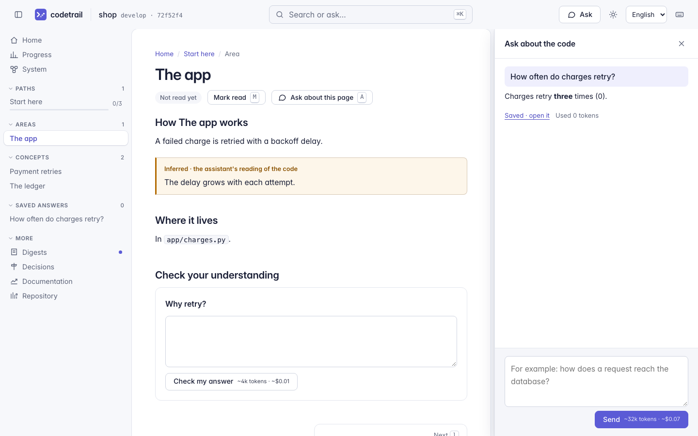
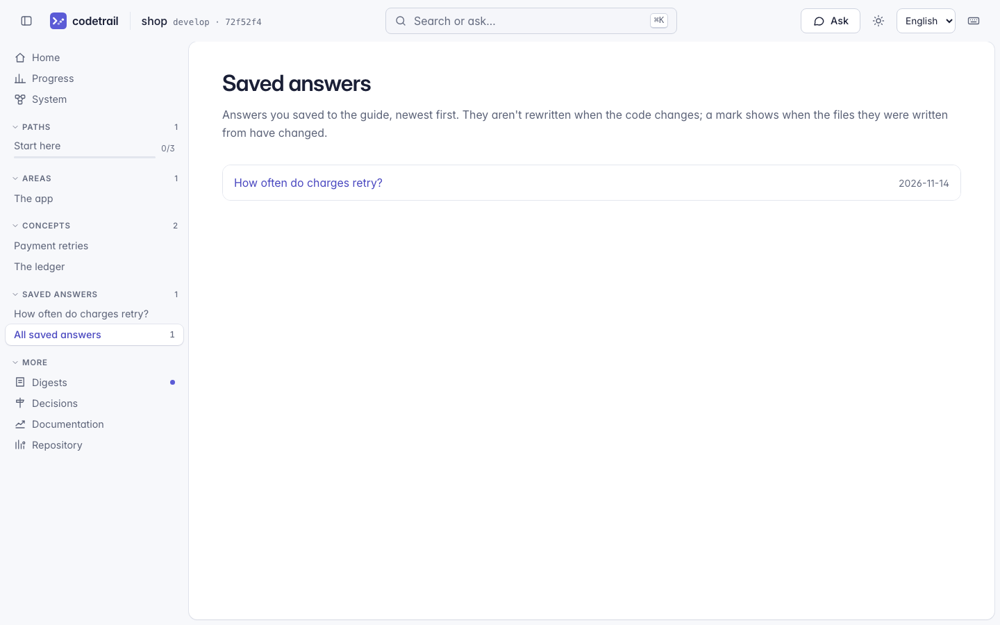
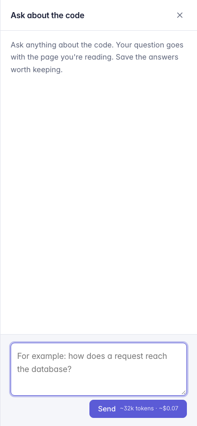

# Search and ask

Search finds anything in the guide in a keystroke, and it is free. Ask sends a question about the code to your assistant, with the page you are reading as context, and lets you keep the answers worth keeping.

**Before you start:** build the guide and open it. See [Your first guide](first-guide.md). To ask, your assistant must be ready: run `codetrail providers` to check (see [Assistants](assistants.md)).

## Search the guide

Search covers page titles, headings and text (areas, concepts, paths and digests), saved answers, decisions, and fact names and kinds. It runs on your machine and costs nothing. It never searches source files, so it cannot show a file Codetrail hides.

1. Press **⌘K** (**Ctrl+K** on Linux) or **/**, or choose the search box in the header.
2. Type a word or the start of one. The last word matches as a prefix, so `retr` finds "retried".
   
3. Results are grouped as **Pages**, **Saved answers**, **Decisions** and **Facts**. Each shows its kind (**Concept**, **Path**, **Digest**, **Area**, and so on) and a snippet with your words highlighted.
4. Move with the up and down arrow keys, press **Enter** to open the result, and **Esc** to close.

If nothing matches, the palette says "Nothing in the guide matches" and your words.

### Run an action from the palette

Under **Actions**, the palette offers:

- **Ask about: "your text"** (shown while you have typed something): opens the Ask panel with your text as the question.
- **See every result for "your text"**: opens the search page.
- **Update the guide…**: opens the update estimate. Nothing is spent until you choose **Go ahead**.
- **Go to progress**.
- **Switch theme**.

### See every result on a page

1. Choose **See every result for "…"** in the palette, or submit the header's search box without the palette's script.
2. The **Search** page lists up to 20 results, each with its kind and a snippet. Change the words in the box and choose **Search** to search again.
   

## Ask a question

1. Open the page you want to ask about. For a general question, any page will do.
2. Press **A**, or choose **Ask** in the header, or **Ask about this page** under the title. The Ask panel, titled **Ask about the code**, slides in beside the page.
3. Type your question in the box. Questions can be up to 4,000 characters.
4. Read the estimate on the **Send** button, for example `~32k tokens · ~$0.07`. Nothing is spent until you choose **Send**.
   
5. Choose **Send**. The status line reads "The assistant is reading the code…" while your assistant reads the repository with read-only tools. Text streams in as plain text.
6. When it finishes, the answer is shown formatted. Under it you see **Save to guide** and what the call used, for example `Used 12k tokens · $0.07`.
   

Your question goes with the page you are reading, so "how often does it retry?" on a page about charges is understood in that context. Answers can include diagrams drawn from the repository's facts.

You can ask one question at a time. The panel keeps this session's answers while you move between pages: up to 20 unsaved answers, the oldest dropped first. Close the panel with the close button or **Esc**.

### Read an answer

Treat an answer as the assistant's reading of the code, not as documented fact. When a saved answer quotes a source, Codetrail checks that the quote is really there. A quote it cannot verify is saved as an inferred block instead of a documented one. See [Reading](reading.md) for what documented and inferred mean.

## Save an answer

1. Under an answer, choose **Save to guide**.
2. The button becomes the link **Saved · open it**. The answer now appears under **Saved answers** in the sidebar.
   
3. Choose the link to open it as a page. It records its question, when it was asked and the commit it was written at.

A saved answer is part of the guide: search finds it, and you can pin it and ask about it. It is not rewritten when the code changes. When files it was written from have changed, it says so: ask again for a fresh answer.

Answers you don't save are gone when you stop `codetrail serve`.

## Find your saved answers

1. Choose **All saved answers** in the sidebar, or press **G** then **S**. The home page also lists your newest saved answers under **Your saved answers**.
2. The **Saved answers** page lists every answer, newest first, with its date. A **sources changed** mark shows when files the answer was written from have changed.
   

## Ask on a narrow window

The panel fills the window. Open it with **Ask** in the header (an icon on narrow windows). Close it with the close button.

## Settings

| Name | Default | What it does |
|---|---|---|
| `[search] max_results` | `20` (1 to 100) | Results a search returns |
| `[search] max_query_chars` | `200` | Longest search text; the rest is cut off |
| `[bridge] max_question_chars` | `4000` | Longest question |
| `[bridge] max_turns` | `20` | Most turns the assistant takes on one question |
| `[bridge] max_budget_usd` | `1.0` | Spending limit for one question |
| `[bridge] max_session_answers` | `20` | Unsaved answers kept per session |
| `[models] answer` | `claude-sonnet-5-5` | The provider and model that answer, as `provider:model` (for example `local:qwen3:14b`, free) |
| `[estimates] answer` | `30000` input, `1500` output tokens | The starting guess for a question, used until Codetrail has history of its own |

See [Settings](settings.md) for where each lives.

## Costs

- **Free:** search, the palette, the search page, opening and listing saved answers. The shortcuts **A**, **U** and **/** only open panels.
- **Paid:** each question is one assistant call. Its estimate is on **Send** before you choose it, and what it used is shown after. On a subscription there is no extra charge: the work counts against your plan's usage limits, and the dollar figure is what the same work would cost at API prices. Use a local model for `answer` to make questions free.

## Troubleshooting

| You see | What it means and what to do |
|---|---|
| Search isn't available right now. The rest of the guide still works. | The search index couldn't be built. The log says why. Restart `codetrail serve`. |
| Nothing in the guide matches "…". | No page, answer, decision or fact has those words. Try a shorter word. |
| Questions are limited to N characters. | Shorten the question. |
| Run `codetrail update <name>` first. | The guide has no snapshot yet. Run the update. |
| That page doesn't exist. | The page you asked about is gone. Open another page and ask again. |
| Another question is still being answered. | Wait for the current answer. |
| The answer was withheld: it contains something that looks like a secret | The answer matched a secret pattern, so nothing was shown or kept. Ask a narrower question. |
| The answer failed (…). | The assistant's program failed. Run `codetrail providers` and try again. |
| That answer is gone; ask again. | The answer was dropped from this session before you saved it. Ask again. |
| An update is running; save again when it finishes. | Saving needs the guide, which an update is changing. Wait for it to finish. |

## See also

- [Reading](reading.md)
- [Getting around](getting-around.md): all the shortcuts
- [Assistants](assistants.md): choosing the model that answers
- [Exploring the code](exploring-the-code.md)
