# Follow your team's repositories

A team follows many repositories from GitHub, Azure DevOps or GitLab, each with its own guide, behind one sign-in. One page shows which repositories have new merges, and one button, **Catch up**, brings every guide up to date for a single estimate. Use it when you look after several repositories that your team merges into every day.

**Before you start:** [write one guide](first-guide.md) so you know what an estimate looks like, and read [Choose assistants and models](assistants.md) if you haven't set up an assistant. The examples use a team called `acme` that follows the organization `acme-org`, which holds `web-shop` and `payments-api`. Use your own names.

## What a team is and what it needs

A team is a name and one or more sources. A source is one place on a hosting service that holds repositories: a GitHub organization or user, an Azure DevOps organization and project, or a GitLab group. For each source you either follow the whole source or choose repositories by hand. Every followed repository is an ordinary Codetrail target, named `<team>-<repository>` (for example `acme-web-shop`), with its own guide and digests.

Codetrail only reads from the hosting service. It never writes to one, and it never reads, stores or passes a token. It talks to the service through the service's own program, and clones with your own git sign-in.

You need:

| Service | Program | Sign in | Let git use the sign-in |
|---|---|---|---|
| GitHub | `gh` | `gh auth login` | `gh auth setup-git` |
| Azure DevOps | `az`, with its extension | `az login` | Git Credential Manager, or an SSH key |
| GitLab (`gitlab.com` only) | `glab` | `glab auth login` | `glab auth login` offers to set up git |

For Azure DevOps, install the extension once:

```bash
az extension add --name azure-devops
```

Run these commands yourself. Codetrail never runs them for you. Git must be able to read each repository without asking, because Codetrail's git never prompts. Only `https` and `ssh` addresses on the service's own host are used.

## Create a team and add repositories

1. Create the team:
   ```bash
   codetrail team add acme
   ```
   The output is:
   ```
   Added team 'acme'. Settings: ~/.config/codetrail/teams/acme.toml
   Codetrail is serving team acme at http://127.0.0.1:8765/
   Sign in (this link works once, for a short time): http://127.0.0.1:8765/login?code=<one-time code>&next=/team/add
   (serving until Ctrl-C)
   ```
   Team names use lower-case letters, digits and hyphens, and are at most 30 characters. Codetrail opens the link in your browser. To print it without opening it, add `--no-browser`. The command keeps serving the team until you press Ctrl-C.
2. Look at the **Services** section of the **Add repositories** screen. Each service shows whether its program is installed and signed in.
   
   - **Signed in as reader** (with a green dot) means the service is ready. "reader" is the account name.
   - **Not installed.** comes with a link to the install page and the command to run next.
   - **Signed out. To sign in, run:** comes with the command, such as `glab auth login`.
   Fix any service you need, then reload the page.
3. Under **Source**, open the picker that says **Choose a source** and pick one, such as `acme-org`. For Azure DevOps, once it is installed and signed in, a field appears where you type the organization (`az` can't list them) and press **List its projects**.
4. Read the **Repositories** list that appears.
   
   - **Follow the whole source** is on by default. Codetrail follows the repositories pushed to in the last 90 days (`[team] active_days`), and the ones that become active later. A source with 600 repositories of which 40 are active gets 40 targets. Archived, empty and disabled repositories are never followed. Azure DevOps reports no push time, so a whole project follows every enabled, non-empty repository.
   - **Filter** narrows the list by name. **Active in the last 90 days** is on by default, and **Show archived** is off.
   - Each row shows the repository's name, when it was last pushed to, its size when the service reports one, and a branch picker. The branch starts as the service's default branch.
5. Untick any repository you don't want. The switch's label then counts them, and the button count follows. Here `payments-api` is unticked:
   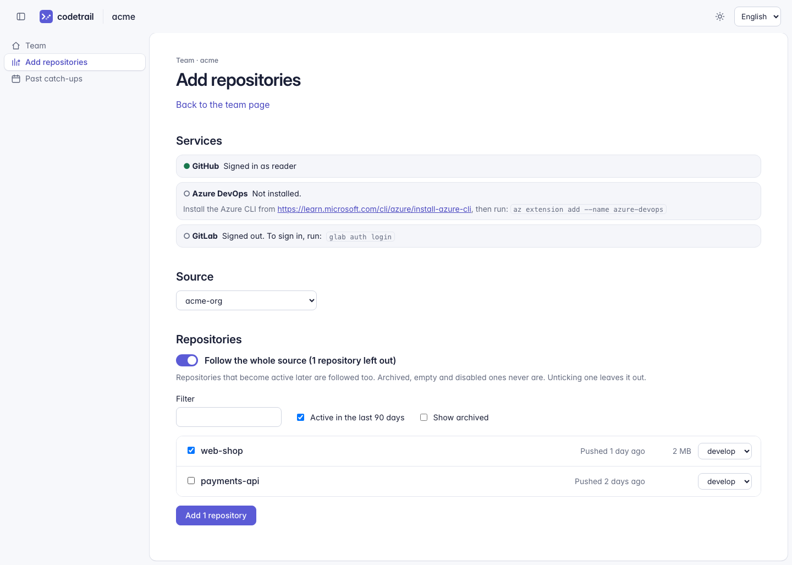
   To choose by hand instead, turn **Follow the whole source** off. The list becomes a selection that starts from what was ticked, and only ticked repositories are followed.
6. Press **Add 1 repository** (the button names the number of new repositories; it reads **Save** when nothing new is added). The **Getting the repositories ready** section appears and shows each step.
   
   Codetrail clones each new repository, reads its facts and builds its "you're behind" signal. This is free. No guide is written yet.
7. Press **Go to the team page**.

What happens next: the team's settings are in `~/.config/codetrail/teams/acme.toml`, and each new repository has a settings file in `~/.config/codetrail/targets/`. Press Ctrl-C in the terminal when you want to stop serving.

If git can't fetch a repository, the refresh fails and the message names the command to run yourself: `gh auth setup-git` for GitHub, `glab auth login` for GitLab, or Git Credential Manager or an SSH key for Azure DevOps. See [Troubleshooting](#troubleshooting).

## Open the team page

1. Serve the team whenever you want to read it:
   ```bash
   codetrail team serve acme
   ```
   The output is:
   ```
   Codetrail is serving team acme at http://127.0.0.1:8765/
   Sign in (this link works once, for a short time): http://127.0.0.1:8765/login?code=<one-time code>
   (serving until Ctrl-C)
   ```
   Add `--no-browser` to print the link without opening it. One sign-in covers the whole team and every repository's guide.
2. Read the page from top to bottom.
   
   - **The header** says "Since you last caught up" with the time the last catch-up finished (or "You haven't caught up yet."), and how many repositories have new merges. **Catch up** and **Add repositories** are below it.
   - **The source line** says which service and source the team follows, how ("Every active repository" or "Chosen repositories"), and how many repositories are left out.
   - **Across the team** is the overview: a short text, written from this catch-up's digests, about how the changes in different repositories connect. It stays until you press **Mark read**. A line below it lists the digests it came from, each a link. A block marked **Inferred** is the assistant's reading of the code. A block marked documented carries a quote from a source that was checked. The overview is in English.
   - **Repositories** has one card for each repository with something new, the busiest first.
   - **Nothing new** is a line listing the quiet repositories, then archived repositories and those that left the source.
3. Read a card.
   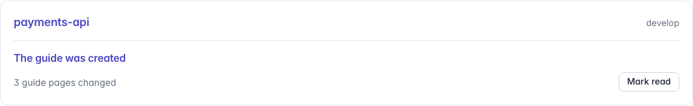
   A card shows the repository's name and branch, how many merges landed and which areas they touched (from the free signal), the unread digest with its highlights (each marked documented or inferred), **Merged by** with the authors' names as git records them, and how many guide pages changed. Codetrail never counts or ranks people.
4. Press **Mark read** on a card when you have read it.
   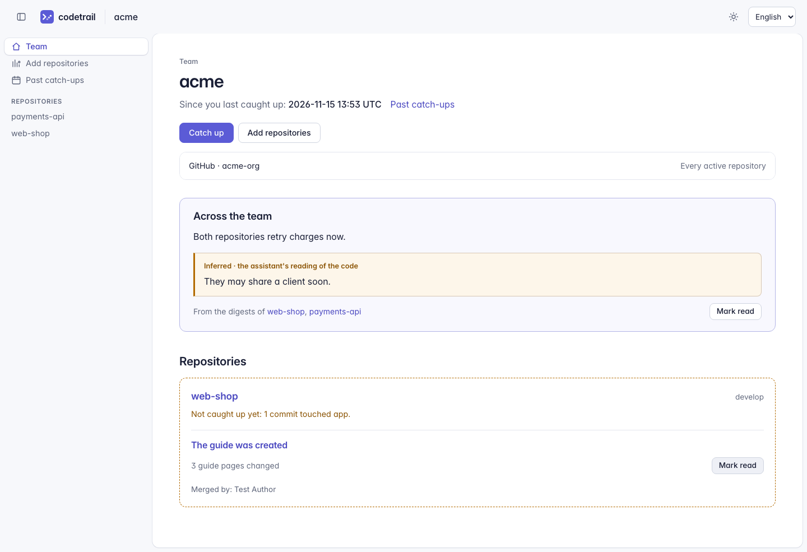
   The card goes away. A digest you read on a repository's own guide counts as read here too, and the other way round.
5. A card with a dashed edge says **Not caught up yet** and the number of commits or merges waiting, for example "Not caught up yet: 1 commit touched app." That is the free part only: the guide hasn't been updated for those changes.

A repository with no guide yet shows on a list row with **No guide yet** and a **Write its guide** link instead of a card.

## Open one repository's guide and come back

1. Press a repository's name on the team page, or pick it in the sidebar under **Repositories**.
2. The repository's guide opens under `/repos/<name>/`. It has all the pages described in [Read the guide](reading.md), and **← Team acme** at the top of its sidebar.
   
3. Press **← Team acme** to go back.
   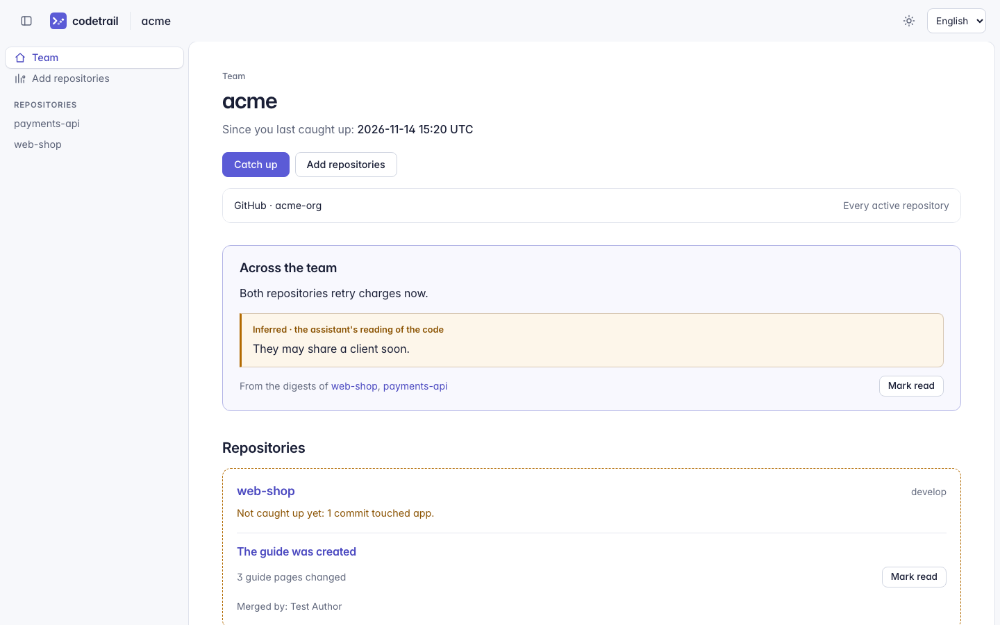

On a phone the same pages fit one column.

1. Open the team page. The buttons and cards stack:
   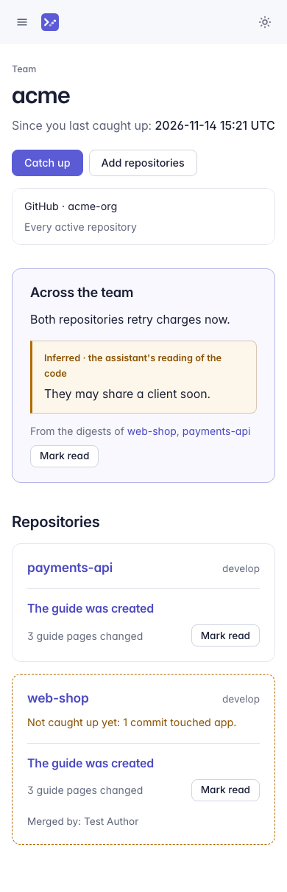
2. Open a repository. Its guide shows the same home page in one column:
   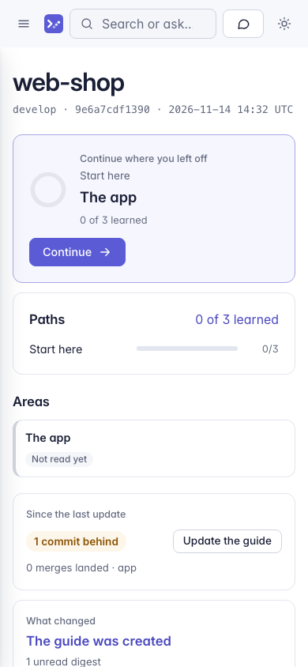
3. Press the menu button at the start of the header. The sidebar opens, and **← Team acme** is at its top:
   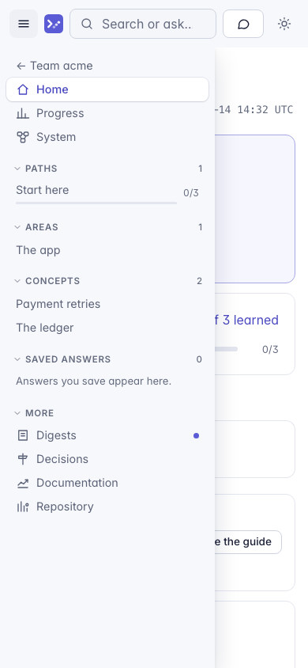

## Catch up on every repository

Catching up has a free part and a paid part. The free part always runs. The paid part runs only after you approve one estimate.

1. On the team page, press **Catch up**.
2. The **Catching up** panel opens and runs the free part for every repository, `[catch_up] concurrency` at a time. Codetrail re-reads the sources, clones new repositories and refreshes every repository's facts. Nothing is spent.
3. A dialog, **Before catching up**, shows the estimate.
   
   - Each repository has its own line and a checkbox, ticked by default. A repository that has no guide yet is marked **first guide**. Its first guide costs the most.
   - **Expected** is the likely figure, and **At most** the largest. Each shows tokens and dollars at API prices.
   - The overview line appears when at least two ticked repositories may write a digest.
   - The totals sit under the table: "Expected: ... tokens; at most ...". "At API prices" gives the dollars. The last sentence says "The catch-up stops starting calls at the team's budget" and names it. The default is $20.00.
   - The dialog also names the sign-in in use and your plan's latest usage, when the provider reports it.
   - A section may add "These repositories won't be caught up, since their refresh failed:" with the reasons.
4. Untick a repository you don't want to update now. The totals change at once.
   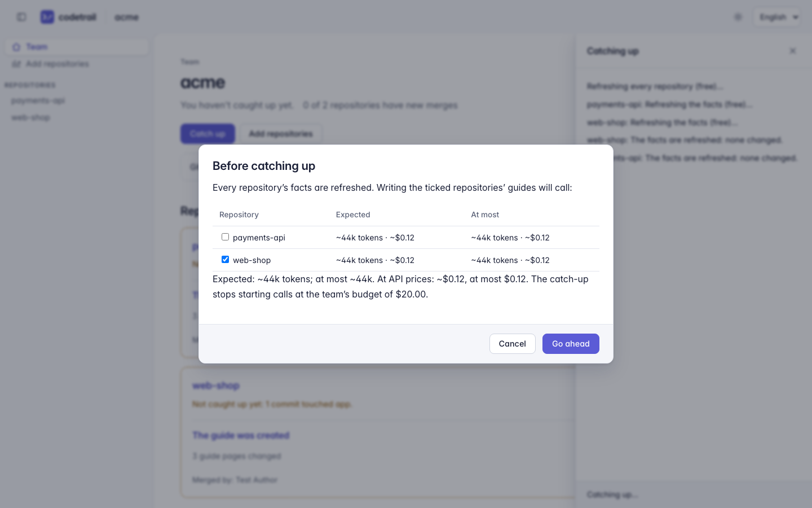
   An unticked repository keeps its free part. Its card says "Not caught up: you left it out of the last catch-up." An unticked first guide is offered again at the next catch-up, until it runs or you leave the repository out. Unticking every repository declines the catch-up, as **Cancel** does. Nothing is spent.
5. Press **Go ahead**. Nothing is spent before you do.
6. Watch the **Catching up** panel. Each step starts with the repository's name.
   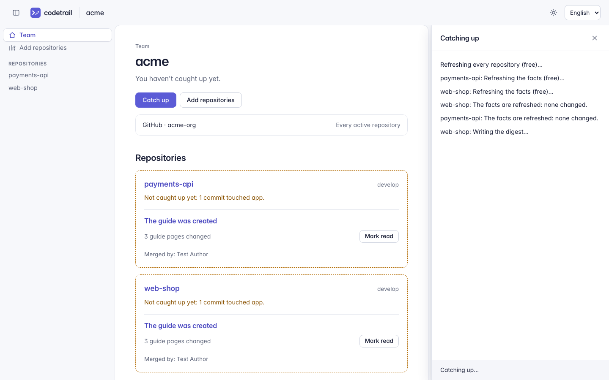
   Codetrail runs the ticked repositories' updates, `[catch_up] concurrency` at a time. Each update has its own lock, its own budget and an all-or-nothing commit, as `codetrail update` does. No call starts past `[catch_up] max_budget_usd`. A repository that fails doesn't stop the others and commits nothing; the panel and its card say why.
7. Wait for the footer to say **Caught up.** The last step reads "One repository caught up." (or the number of repositories).
   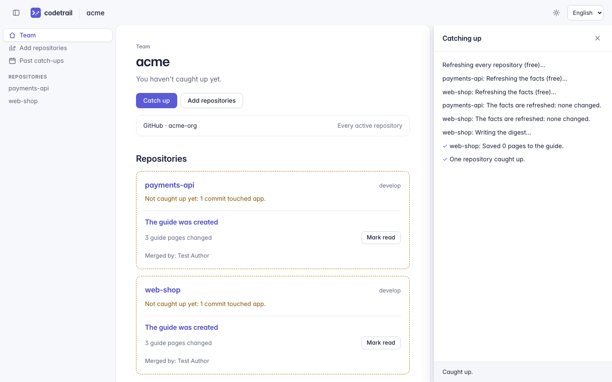
8. When the catch-up is done, the team page shows the new cards.
   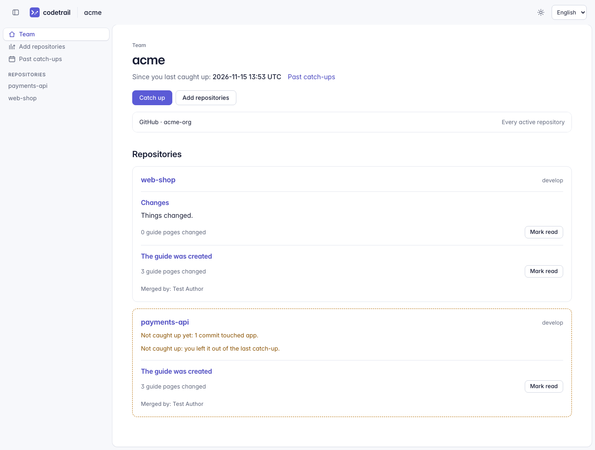

After a catch-up, wait a few minutes before the next. The page says "A catch-up finished a moment ago; wait a few minutes before the next." until `[server] update_cooldown_seconds` (300 seconds) has passed. One catch-up runs per team at a time.

### Catch up from the terminal

1. Run:
   ```bash
   codetrail team update acme
   ```
   The first catch-up of two new repositories looks like this:
   ```
   payments-api: started, refreshing the facts (free).
   web-shop: started, refreshing the facts (free).
   This catch-up will call:
     payments-api (first guide): plan    claude_code · claude-opus-5-5: 1 call(s), ~68k tokens each (a starting guess), ~$0.40 each
     payments-api (first guide): write   claude_code · claude-sonnet-5-5: 20 to 40 call(s), ~126k tokens each (a starting guess), ~$0.30 each
     payments-api (first guide): digest  claude_code · claude-sonnet-5-5: 1 call(s), ~44k tokens each (a starting guess), ~$0.12 each
     web-shop (first guide): plan    claude_code · claude-opus-5-5: 1 call(s), ~68k tokens each (a starting guess), ~$0.40 each
     web-shop (first guide): write   claude_code · claude-sonnet-5-5: 20 to 40 call(s), ~126k tokens each (a starting guess), ~$0.30 each
     web-shop (first guide): digest  claude_code · claude-sonnet-5-5: 1 call(s), ~44k tokens each (a starting guess), ~$0.12 each
     The team: overview claude_code · claude-sonnet-5-5: 1 call(s), ~16k tokens each (a starting guess), ~$0.04 each, once two repositories have new digests
   Expected: ~5.3M tokens (at most ~10.0M), ~$13.28 (at most $20.00) at API prices. The catch-up stops starting calls at the team's budget of $20.00.
   Continue? [y/N]
   ```
   The free part runs first. Then the estimate appears, with every repository's calls on their own lines. "(a starting guess)" shows until Codetrail has history of its own; later estimates use the median of your recent calls.
2. Answer `y` to go ahead, or `n` (or just press Enter) to stop. The output continues:
   ```
   payments-api: wrote “The app”.
   web-shop: wrote “The app”.
   ...
   payments-api: writing the digest.
   web-shop: writing the digest.
   web-shop: done, 3 pages saved to the guide.
   payments-api: done, 3 pages saved to the guide.
   Writing the team overview.
   Overview written (overviews/2026-11-14-143521).
   ```
   On `n`, it prints `Nothing was updated.` and spends nothing.
3. A later catch-up, after one new commit in each repository, has a much smaller estimate:
   ```
   This catch-up will call:
     payments-api: digest  claude_code · claude-sonnet-5-5: 1 call(s), ~44k tokens each (a starting guess), ~$0.12 each
     web-shop: digest  claude_code · claude-sonnet-5-5: 1 call(s), ~44k tokens each (a starting guess), ~$0.12 each
     The team: overview claude_code · claude-sonnet-5-5: 1 call(s), ~16k tokens each (a starting guess), ~$0.04 each, once two repositories have new digests
   Expected: ~104k tokens (at most ~104k), ~$0.28 (at most $0.28) at API prices. The catch-up stops starting calls at the team's budget of $20.00.
   ```

To skip the question, add `--yes`:

```bash
codetrail team update acme --yes
```

`--yes` runs every repository in the estimate, including each new repository's first guide, within the team's budget. Without a terminal and without `--yes`, Codetrail prints `There's no terminal to ask in, so nothing was spent. Run again with --yes to go ahead.` and exits with status 2.

The terminal catch-up has no checkboxes. It updates every repository in the estimate, or none. To leave a repository out, untick it on the **Add repositories** screen (see [Leave a repository out](#leave-a-repository-out)).

## See your teams

```bash
codetrail team list
```

```
acme: github:acme-org (all) - 2 targets
```

Each team shows its sources as `service:source (all)` or `(chosen)`, and how many targets it follows. There is no `codetrail target list`. Look in `~/.config/codetrail/targets/` for every target.

## Add repositories later

1. Open the team page with `codetrail team serve acme`.
2. Press **Add repositories**, or choose **Add repositories** in the sidebar.
3. Pick the source. Repositories the team already follows are ticked. A followed repository keeps its branch; the screen doesn't change it.
4. Tick the repositories to add, then press the button. It reads **Add N repositories** for new ones and **Save** when you only left some out.

Each new repository gets the free refresh at once. Its first guide waits for your next catch-up, where it has its own line in the estimate.

You can also add another source (another organization, or a project on another service) by picking it in the **Source** picker and saving.

`team serve` lists your sources once when it starts. A page view writes no settings and never clones. Restart `codetrail team serve acme` to see repositories added or archived on the service since.

## Leave a repository out

1. Open **Add repositories** and pick the source.
2. Untick the repository. With **Follow the whole source** on, the switch's label counts it as left out. A repository that becomes active again later stays left out.
3. Press **Save**.

The repository stops being refreshed. Its data stays on your machine. A repository that is archived, or has left its source, stops being refreshed too, and the page lists it under "Archived, or no longer in their source."

## Delete one repository's data

Leaving a repository out never deletes anything. To delete its data:

1. Leave the repository out (see above).
2. Stop `codetrail team serve` with Ctrl-C. A running server holds every repository's lock.
3. Run:
   ```bash
   codetrail target remove acme-web-shop
   ```
   The output is:
   ```
   Removing target 'acme-web-shop' deletes:
     ~/.local/share/codetrail/acme-web-shop
     ~/.config/codetrail/targets/acme-web-shop.toml
   The repository itself isn't touched.
   Remove target 'acme-web-shop' and delete these? [y/N]
   ```
   Answer `y`. Add `--yes` to skip the question.

`codetrail target remove` refuses while the team still follows the repository. It names the team and says to leave the repository out first.

## Remove a team

1. Stop `codetrail team serve` if it is running.
2. Run:
   ```bash
   codetrail team remove acme
   ```
   The output lists what it deletes and asks first:
   ```
   Removing team 'acme' deletes:
     ~/.config/codetrail/teams/acme.toml
     ~/.local/share/codetrail/teams/acme
     ~/.local/share/codetrail/acme-payments-api
     ~/.config/codetrail/targets/acme-payments-api.toml
     ~/.local/share/codetrail/acme-web-shop
     ~/.config/codetrail/targets/acme-web-shop.toml
   Nothing on the hosting services is touched.
   Remove team 'acme' and delete these? [y/N] y
   Removed team 'acme'.
   ```

Nothing on GitHub, Azure DevOps or GitLab changes. Add `--yes` to skip the question.

## Settings

Global settings go in `~/.config/codetrail/config.toml`. The team's own settings are in `~/.config/codetrail/teams/<name>.toml`.

| Setting | Default | What it does |
|---|---|---|
| `[team] active_days` | 90 | A whole source follows repositories pushed to within this many days (1 to 3650). |
| `[team] highlights_per_digest` | 3 | Highlights a digest carries for the cards (0 to 10). |
| `[team] max_overview_words` | 250 | Longest the overview may be (50 to 1000). |
| `[hosting] gh`, `az`, `glab` | `gh`, `az`, `glab` | The service programs to run. |
| `[hosting] timeout_seconds` | 60 | Time limit of each program run (5 to 600). |
| `[hosting] max_output_bytes` | 10,000,000 | Largest output Codetrail accepts from one program run. |
| `[hosting] max_repositories_per_source` | 1000 | Most repositories read from one source (1 to 10,000). |
| `[hosting] concurrency` | 4 | Repositories whose signal is fetched, or first refreshed, at once (1 to 16). |
| `[estimates] overview` | 15,000 input and 1,500 output tokens | Starting guess for the overview call. |
| `[server] update_cooldown_seconds` | 300 | Wait between catch-ups started from the page. |
| `[server] estimate_ttl_seconds` | 300 | How long the estimate dialog waits for **Go ahead** before the catch-up stops without spending. |
| `[server] port` | 8765 | The port of the local page (1024 to 65535). |
| `[[sources]] service` (team file) | none | `github`, `azure_devops` or `gitlab`. |
| `[[sources]] source` (team file) | none | The organization, user, project or group. |
| `[[sources]] follow` (team file) | `all` | `all` for the whole source, or `chosen` for a list. |
| `[[sources]] clone_over` (team file) | `https` | `https` or `ssh`. Not on the screen; edit the file. |
| `[[sources]] left_out` (team file) | none | The services' ids of the repositories left out while following everything. |
| `[[sources]] chosen` (team file) | none | The ids of the repositories followed when `follow = "chosen"`. |
| `[models] overview` (team file) | `claude-sonnet-5-5` | Provider and model of the overview. It can't be Codex. |
| `[catch_up] max_budget_usd` (team file) | 20.0 | The whole catch-up's spend across its repositories. |
| `[catch_up] concurrency` (team file) | 2 | Repositories updated at once (1 to 8). |
| `[catch_up] max_budget_usd_per_call` (team file) | 1.0 | The limit of the overview's one call. |

A followed repository's own settings (its models, budgets and `[assistant] allow_codex`) are in its target file. See [Choose assistants and models](assistants.md).

## Costs

- **Free:** the source lists, cloning, reading facts, the "you're behind" signal, the team page, **Mark read**, and every list on the **Add repositories** screen. Adding repositories spends nothing.
- **Paid:** the guide of each ticked repository (the plan, the pages and the digest) and the overview, one call. Each runs on the assistant you chose.
- **The estimate comes first.** The dialog, or the terminal question `Continue? [y/N]`, shows each repository's calls and the total before anything is spent. A new repository's first guide has its own line, so a repository that becomes active never costs you money without your seeing it.
- **The team's budget** (`[catch_up] max_budget_usd`, $20.00 by default) caps the whole catch-up. Every call reserves its cap before it starts, so no call starts past the budget. The totals in the estimate never go above it. When the budget is spent, a repository whose turn hadn't come isn't updated and says so.
- On a subscription, the dollars are what the same work would cost through the API; your real cost is your plan's usage.

## Troubleshooting

| Message | Meaning and fix |
|---|---|
| `Not installed.` with an install link | The service's program is missing. Install it and run the command shown. |
| `Signed out. To sign in, run:` and a command | Run the command, then reload the page. |
| `No source to show yet: sign in to a service, or name an Azure DevOps organization.` | No signed-in service has a source. Sign in to one, or type an Azure DevOps organization. |
| `Couldn't list them just now.` | The service didn't answer. Try again. |
| `Its sources couldn't be listed just now.` (or a chip, `couldn't be listed just now`, beside the source) | The service didn't answer while the page listed sources. Codetrail keeps the repositories it has. Restart `codetrail team serve` later. |
| `Couldn't list the team's sources: <reason>` (terminal) | Same, in `codetrail team update`. The catch-up carries on with the repositories it already follows. |
| `Couldn't save the selection.` | The save was refused. Reload the page and try again. |
| `<repository> couldn't be refreshed: <reason>` | Cloning or fetching failed. The reason names the command to run yourself: `gh auth setup-git`, `glab auth login`, or Git Credential Manager or an SSH key. The other repositories carry on. |
| `Saved, but the server is stopping: the new repositories get ready at the next catch-up.` | You stopped the server too soon. The next catch-up gives them their free refresh. |
| `A catch-up is already running.` / `Team 'acme' is already catching up.` | Wait for the running one to finish. |
| `A catch-up finished a moment ago; wait a few minutes before the next.` | The page's cooldown (`[server] update_cooldown_seconds`) hasn't passed. |
| `The team's budget is spent, so this repository wasn't updated.` | The catch-up reached `[catch_up] max_budget_usd`. Run another catch-up, or raise the budget. |
| `Not caught up in the last catch-up: <reason>` | That repository's update failed. Its guide is as before. The reason says why. |
| `Not caught up: you left it out of the last catch-up.` | You unticked it. Catch up again and keep it ticked. |
| `This catch-up has no overview: <problem>` (page) or `No overview was written: <problem>` (terminal) | The overview call or its checks failed. The cards are still there. |
| `There's no terminal to ask in, so nothing was spent. Run again with --yes to go ahead.` | `codetrail team update` ran without a terminal. Add `--yes` if you accept the estimate. |
| `Nothing was updated.` | You answered no to the question. |
| `Couldn't mark it read. Try again.` | The read mark wasn't saved. Press **Mark read** again. |
| `Team 'acme' is in use: stop codetrail team serve for it, or wait for its sync to finish.` | Stop the server before `codetrail team remove`. |
| `Target 'acme-web-shop' is in use: stop the Codetrail server serving it (codetrail serve or codetrail team serve), or wait for its update to finish.` | Stop the server before `codetrail target remove`. |
| `acme-web-shop is followed by team acme: leave it out on the team page (Add repositories), then run codetrail target remove again.` | Leave the repository out first. |
| `A team named 'acme' already exists: <file>` | Pick another name, or use the team that exists. |
| `'<name>' isn't a valid team name: use lower-case letters, digits and hyphens, starting with a letter or digit, at most 30 characters.` | Change the name. |
| `No team named 'acme'.` | Check the name with `codetrail team list`. |
| `The team's overview can't use Codex: ...` | Remove the Codex value from `[models] overview` in the team file. |

## See also

- [Choose assistants and models](assistants.md): the models and budgets a catch-up uses.
- [Update the guide](updating.md): the same estimate for a single repository.
- [Read the guide](reading.md) and [Digests](digests.md): what each followed repository's guide and digests contain.
- [Settings](settings.md): every setting in one place.
- [Troubleshooting](troubleshooting.md).
