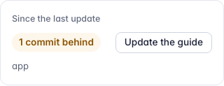
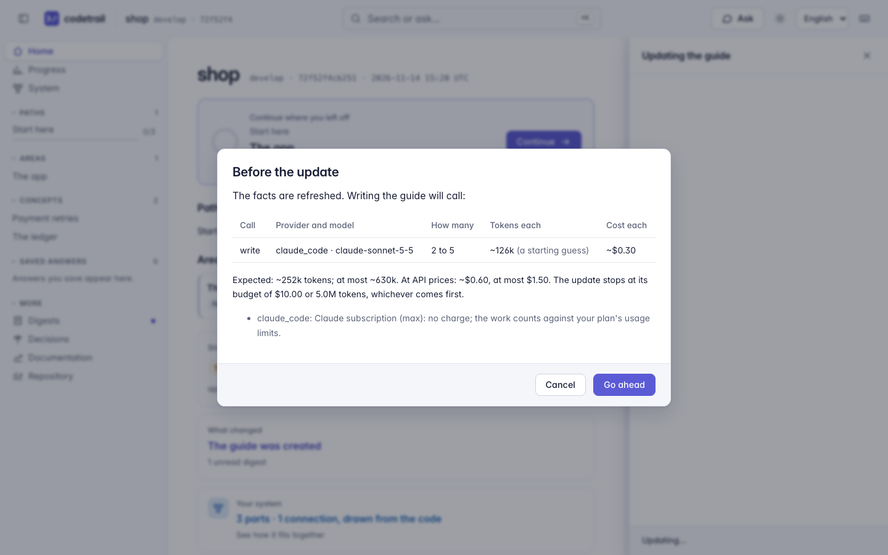
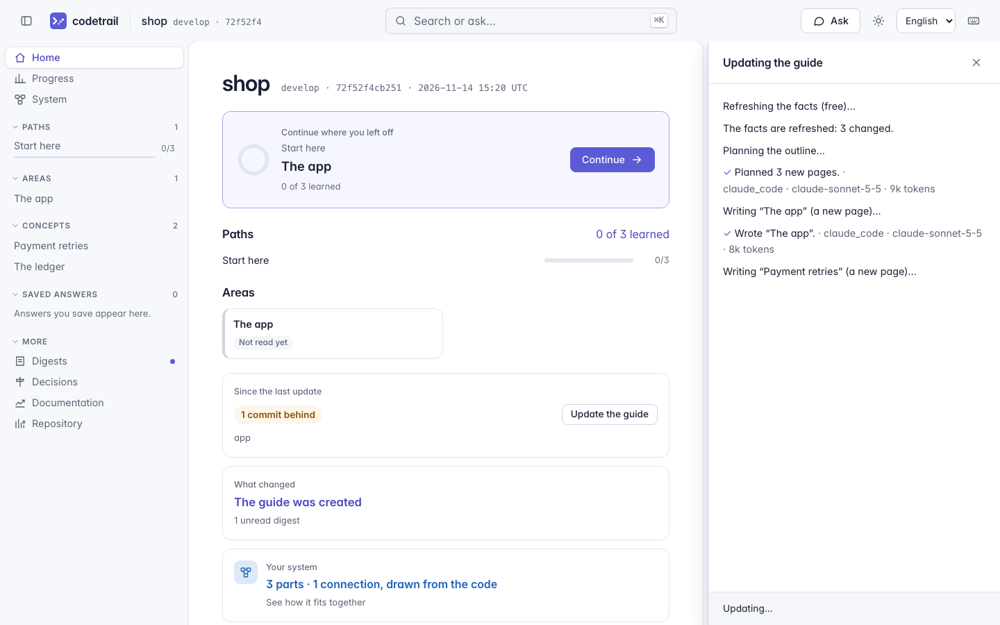
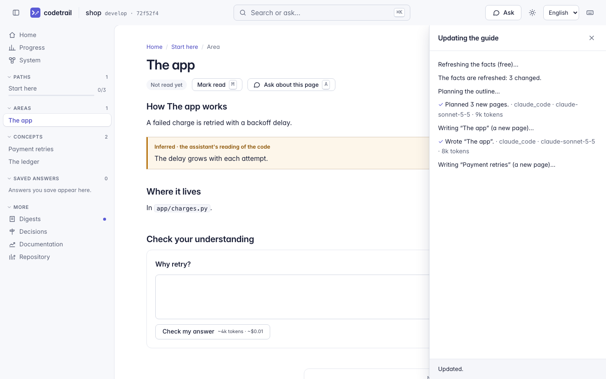

# Keeping the guide up to date

The guide is a snapshot. When the repository moves on, the page tells you how far behind the guide is, and you update it. An update rewrites only the pages whose facts changed, and writes a digest of what changed and why. Pages this update's changes touch go first, then the pages you learned, then new pages.

You can update from the page or from the terminal. Both show the estimate first and spend nothing until you say so.

**Before you start:** build a first guide (see [Your first guide](first-guide.md)) and have an assistant that is `ready` in `codetrail providers`.

## See how far behind the guide is

1. Run `codetrail serve shop` and open the home page (see [Your first guide](first-guide.md)).
2. Find the **Since the last update** card in the rail beside the main column.

   

   The chip says how far the branch has moved:
   - **Up to date**, with "The guide matches the branch."
   - **N commits behind**, with how many merges landed (only when some did) and up to three areas the changes touched.
   - **No guide yet**, before the first update.
   - **…** and "An update is running." while an update runs.
   - **—** and "Couldn't check for new commits just now." when Codetrail couldn't read the branch.

   When the guide has been updated, the card also says how much the last update used: "The last update used ~N tokens ($ at API prices)."

The check is free. It counts from the commit the guide last covered, the end of its newest digest, so an update run with `--facts-only` doesn't reset it: the card keeps saying how far behind the guide is until a full update. The result is kept for `[signal] cache_seconds` (60 by default), so a new commit can take up to a minute to show.

## Update the guide from the page

1. Choose **Update the guide** on the card, or press **U** on any page. The page refreshes the facts, which is free, and then shows the estimate.

   

2. Read the estimate:
   - The table lists each kind of call (`plan`, `write`, `digest`), its provider and model, how many calls, the tokens each and the cost each. "a starting guess" marks a number made before Codetrail has a history of its own calls. A local model shows **free**; a model with no price shows **no price configured**.
   - **Expected** is the likely total; "at most" counts every page being written twice, since a page that fails validation is written once more. It never goes past the budget.
   - The dollars are what the same work would cost at API prices. On a subscription the note under the table says there is no charge and that the work counts against your plan's usage limits.
   - A list of the pages follows, in the order they are written, each with the reason: a new page, one of its facts changed, its outline entry changed, or catching up. A page marked **revised** has only its affected sections rewritten.
   - The update stops at its budget, which the estimate also states.

3. Choose **Go ahead** to start, or **Cancel** to stop. Nothing is spent until you choose **Go ahead**. If you leave the dialog for longer than `[server] estimate_ttl_seconds` (300 seconds), the estimate expires and the panel says "The estimate expired before it was confirmed, so nothing was spent."

4. Watch the **Updating the guide** panel. On a wide window the page moves over to make room for it. Each step appears as it happens; a finished call shows the provider, the model and the tokens it used.

   

5. Wait for the foot of the panel to say **Updated.** A moment later the page reloads with the new pages.

   

   The panel says **The update failed:** with the reason when it fails. If you cancel, it says the update was cancelled and that the facts were refreshed but the guide wasn't updated.

Only one update runs at a time. After one finishes, the next waits for `[server] update_cooldown_seconds` (300 seconds, five minutes). If you stop `codetrail serve` (Ctrl-C) while an update runs, the update stops with it and the guide stays as it was before that update.

## Update the guide from the terminal

1. Run:

   ```bash
   codetrail update shop
   ```

   Codetrail refreshes the facts and prints the estimate with the same parts as the page:

   ```
   This update will call:
     plan    claude_code · claude-opus-5-5: 1 call(s), ~68k tokens each (a starting guess), ~$0.40 each
     write   claude_code · claude-sonnet-5-5: 8 to 16 call(s), ~126k tokens each (a starting guess), ~$0.30 each
     digest  claude_code · claude-sonnet-5-5: 1 call(s), ~43k tokens each (a starting guess), ~$0.11 each
   Expected: ~1.1M tokens (at most ~2.1M), ~$2.91 (at most $5.31) at API prices. The update stops at its budget of $10.00 or 5.0M tokens.
   claude_code: Claude subscription (max), so no charge; the work counts against your plan's usage limits.
   Continue? [y/N]
   ```

   The numbers here are an example; yours differ.

2. Type `y` and press Enter to go ahead. Anything else stops, and the facts stay refreshed:

   ```
   The facts were refreshed; the guide wasn't updated.
   ```

3. Read the summary:

   ```
   Updated shop at commit 9e6a7cdf1390 (snapshot 2).
   Facts: 8 entities, 5 relations.
   System connections: deployed on 1
   Changes (+ added, ~ changed, - removed):
     module: +2 ~0 -0
   Guide: 3 pages written, 0 failed, 0 left for the next update; used ~… tokens, $… at API prices.
     Digest: digests/2026-11-14-9e6a7cdf1390
   ```

   `Changes` counts the facts that were added, changed or removed since the last update. `Guide` counts the pages. A page that failed is listed as `Not rewritten:` with its reason, and pages the budget left out wait for the next update.

If there is nothing for the assistant to do, it prints "Nothing for the assistant to do in this update." and goes on.

### Options

| Option | What it does |
|---|---|
| `--yes` | Shows the estimate, then goes ahead without asking. Use it in a script. |
| `--facts-only` | Refreshes the facts and calls no assistant. Free. No estimate, no question. |
| `--retry-failed` | Writes pages that failed last time even if nothing in them changed. |

Without a terminal to ask in (a script, a cron job), `codetrail update` prints the estimate, spends nothing and exits with code 2. Add `--yes` to go ahead.

A page that failed last time, and whose facts haven't changed since, is skipped. The summary says `Skipped:` and prints the command to write them anyway:

```bash
codetrail update shop --retry-failed
```

## Smaller updates

The first update writes up to 20 pages. To keep any update smaller, add to `~/.config/codetrail/targets/shop.toml`:

```toml
[generation]
max_pages_per_update = 8
```

The pages left out are written by later updates.

## Settings

These are in the target's file (`~/.config/codetrail/targets/<name>.toml`) unless noted.

| Setting | Default | What it does |
|---|---|---|
| `[generation] max_pages_per_update` | `20` | The most pages one update writes. The rest wait. |
| `[generation] max_budget_usd_per_update` | `10.0` | The update's budget in dollars at API prices. |
| `[generation] max_tokens_per_update` | `5000000` | The update's token budget, counted for every provider. |
| `[generation] max_budget_usd_per_call` | `1.0` | The most one call may cost. Each call reserves it before it starts. |
| `[generation] concurrency` | `2` | Pages written at once. |
| `[generation] revise_max_changes` | `20` | A page with at most this many changes since it was written is revised, not rewritten. `0` writes every page whole. |
| `[server] update_cooldown_seconds` (`config.toml`) | `300` | How long after an update finishes before the page starts another. |
| `[server] estimate_ttl_seconds` (`config.toml`) | `300` | How long the page keeps an estimate waiting for **Go ahead**. |
| `[signal] cache_seconds` (`config.toml`) | `60` | How long the "behind" check is kept. |
| `[estimates]` (`config.toml`) | see [Settings](settings.md) | The starting guesses for tokens per call, used until Codetrail has a history. |

## Costs

**Free:** the facts (`--facts-only`, and the first step of every update), the "behind" check, reading, searching, `codetrail files`, `codetrail metrics` and `codetrail stats`.

**Paid, on your assistant's plan:** the calls an update makes: `plan` (the outline), `write` (the pages) and `digest`. The estimate shows them before anything runs, in the terminal before `Continue? [y/N]` and on the page before **Go ahead**. A call to a local model is free. Questions and checks have their own estimates (see [Search and ask](search-and-ask.md) and [Reading and learning](reading.md)).

**Estimates:** until Codetrail has recorded three calls of the same kind, provider and model, an estimate uses starting guesses and says so. After that it uses the median of your most recent calls (`[estimates] history_size`, 20 by default).

**Budgets** cap what an update spends, whichever limit comes first:
- Each paid call reserves its cap (`max_budget_usd_per_call`) in the update's budget before it starts. When the budget can't hold another cap, no more calls start, and the pages not yet written wait for the next update.
- A running call can pass its own cap only by its last turn.
- The token budget counts every provider, including models with no price.
- A local model reserves nothing.

## Troubleshooting

| You see | What it means and what to do |
|---|---|
| `Target 'shop' is already updating; try again when that finishes.` | Another update, from the page or the terminal, holds the target. Wait for it. |
| `Target 'shop' is being removed.` | `codetrail target remove` is running. |
| An update finished a moment ago; wait a few minutes before the next. | The page's cooldown (`update_cooldown_seconds`). Wait, or update from the terminal. |
| An update is already running. | Only one update runs at a time. |
| The estimate expired before it was confirmed, so nothing was spent. | You waited longer than `estimate_ttl_seconds`. Choose **Update the guide** again. |
| `There's no terminal to ask in, so nothing was spent. Run again with --yes to go ahead.` | `codetrail update` ran without a terminal and exited with code 2. Read the estimate, then add `--yes`. |
| `The update's budget ($…) is smaller than one call's cap ($…), so no call can start; …` | Raise `[generation] max_budget_usd_per_update`, or lower `max_budget_usd_per_call`. |
| `The guide at … has uncommitted edits; commit or discard them before updating.` | The guide is its own git repository under `~/.local/share/codetrail/<name>/guide`. Someone edited it by hand. Commit or discard the edits. |
| `The assistant's outline had no page Codetrail could use: …` | The `plan` call's answer was unusable. Run the update again. |
| `Not rewritten: <page> (…)` | That page failed. Its reason is in brackets. It is skipped until its facts change; use `--retry-failed` to try again. |
| `“…” waits for the next update: the budget is spent.` | The budget ran out. Run another update, or raise the budget. |
| `The server stopped, so the update stopped; the guide wasn't changed.` | You stopped `codetrail serve` during the update. Run it again. |
| `The update failed (…).` | An unexpected error; the name in brackets is its type. Run the update from the terminal to see more. |
| `claude_code isn't ready. …` | The assistant isn't installed or signed in. Follow the fix it prints, then check `codetrail providers`. |

More messages, grouped by feature, are in [Troubleshooting](troubleshooting.md).

## See also

- [Your first guide](first-guide.md)
- [Digests](digests.md), which each update writes
- [Assistants](assistants.md), to choose the provider and model of each call
- [Teams](teams.md), to catch up many repositories at once
- [Settings](settings.md)
